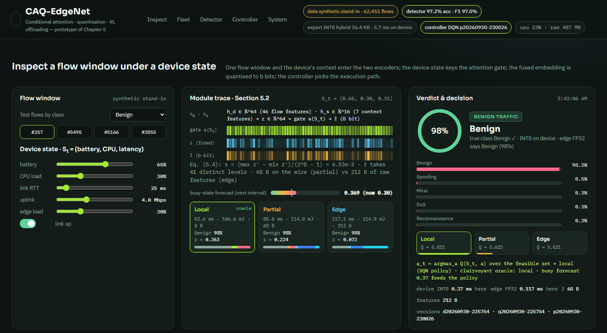
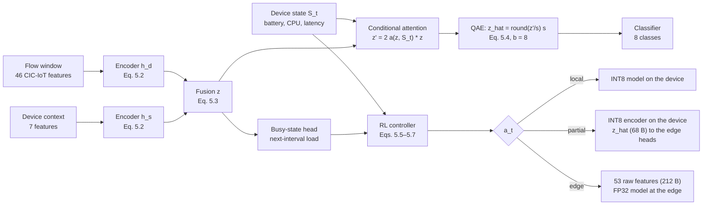
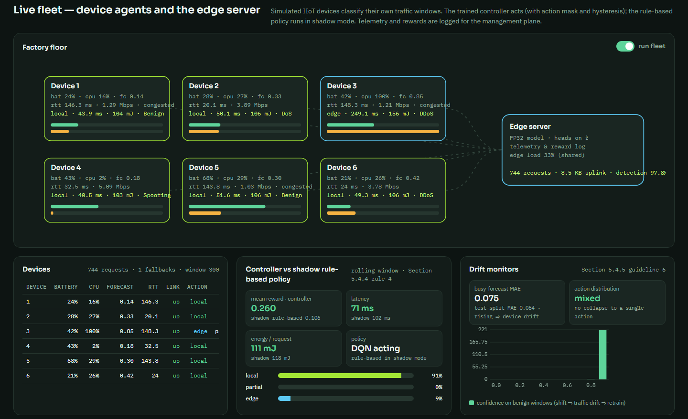
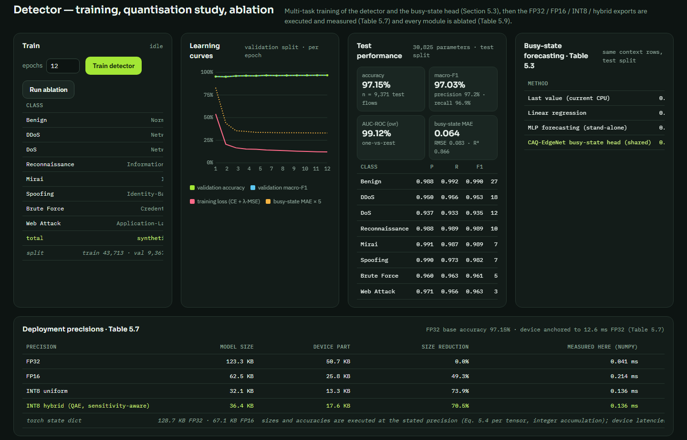
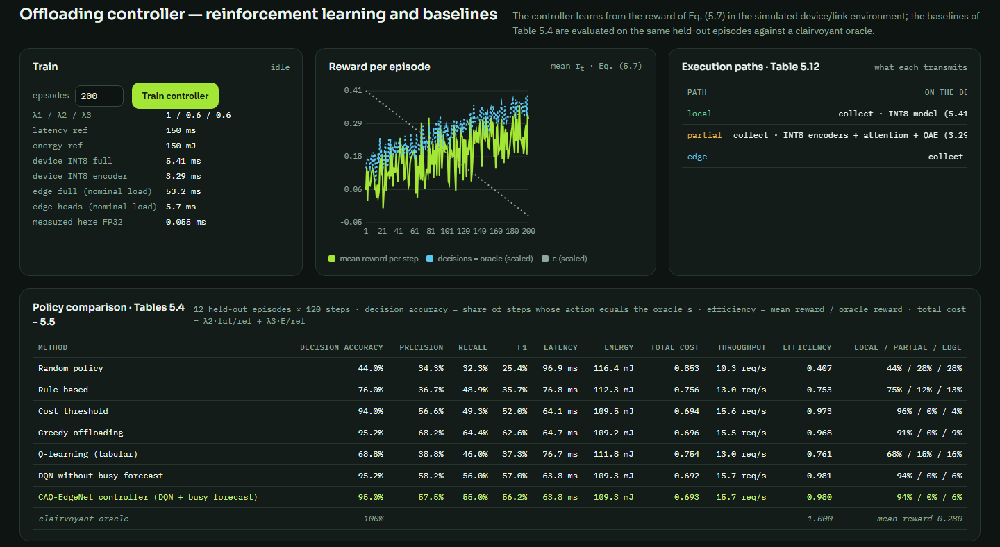

# CAQ-EdgeNet-Prototype

**A runnable system prototype of CAQ-EdgeNet: conditional attention, quantisation-aware compression and reinforcement-learning offloading for malware detection on mobile Industrial IoT devices**

[](requirements.txt)
[](LICENSE)
[](#citation)
[](docs/DATASETS.md)



---

## Overview

Malware and intrusion detection on Industrial IoT (IIoT) and mobile edge devices is constrained by more than accuracy. The same model, executed in the wrong place, drains the battery or misses its deadline. The resources that decide the right place change from second to second: battery level, CPU load and link latency. Four techniques address these constraints: lightweight models, attention, quantisation and offloading. They are usually studied separately.

CAQ-EdgeNet (**C**onditional **A**ttention and **Q**uantisation-based **Edge Net**work, thesis Chapter 5) integrates them in one multi-task model:

1. **Multi-modal feature encoder.** It encodes dynamic network-level flow features and static or device-context features separately (Eq. 5.2) and fuses them into an embedding $z$ (Eq. 5.3).
2. **Conditional attention.** A gate keyed on the device state $S_t = (\text{battery}, \text{CPU}, \text{latency})$ re-weights $z$ (the *FusionCAB* block).
3. **Quantisation-aware compression.** It quantises the attended embedding to $b$ bits (Eq. 5.4), and uses a sensitivity-aware hybrid precision for the layers.
4. **Multi-task heads.** An eight-class traffic classifier (benign plus seven attack classes of CIC-IoT-2023) and a **busy-state head** that forecasts the device load one interval ahead.
5. **RL offloading controller.** A controller chooses **local**, **partial** (send only the quantised embedding) or **edge** execution (Eq. 5.6), and learns from the reward $r_t = \lambda_1\,\text{Accuracy} - \lambda_2\,\text{Latency} - \lambda_3\,\text{Energy}$ (Eq. 5.7).

This repository contains the **system prototype** of that framework. It has device agents, a shared edge server, a telemetry and reward log, a management plane with versioned detector, export and policy, and an analyst dashboard. It was built for the design-and-deployment chapter of the PhD thesis. The detector is **trained**, the FP32, FP16, INT8 and hybrid exports are **executed and measured**, and the controller is **trained by reinforcement learning** in a device and network simulator whose parameters are documented in `config.yaml`.

## What the prototype demonstrates

| Capability | Where it is implemented | Thesis reference |
|---|---|---|
| CIC-IoT-2023 loader (46 flow features, 34 labels → 8 classes of Table 5.2) with a synthetic stand-in when the CSVs are absent | [`caqedge/data.py`](caqedge/data.py) | Section 5.1, Tables 5.1–5.2 |
| MDF-style device-context simulator (battery, CPU, memory, network, applications, time of day) with a next-interval busy-state target | `DeviceContextSim` | Table 5.1, Section 5.3.3 |
| CAQEdgeNet in PyTorch: two encoders, fusion, state-keyed attention gate, fake-quantisation with a straight-through estimator, classifier, busy head | [`caqedge/model.py`](caqedge/model.py) | Eqs. 5.1–5.4 |
| Multi-task training and test metrics (accuracy, macro-F1, AUC, confusion, busy-state MAE, RMSE, R²) | `train_model`, `evaluate` | Tables 5.3, 5.8 |
| Precision runtimes executing FP32, FP16, uniform INT8 and a sensitivity-aware hybrid map (integer accumulation), for measured size and accuracy | `NumpyRuntime` | Section 5.2.3, Table 5.7 |
| Cost model of the three execution paths (what runs where, what is transmitted), reward of Eq. 5.7 | [`caqedge/simulator.py`](caqedge/simulator.py) | Eqs. 5.5–5.7, Table 5.12 |
| DQN controller with the busy forecast in its state; baselines: random, rule-based, cost threshold, greedy, tabular Q-learning, DQN without forecast | [`caqedge/controller.py`](caqedge/controller.py) | Section 5.2.4, Tables 5.4–5.5 |
| Ablation of the modules (attention, QAE, busy head, shared learning, context modality) | `Engine.run_ablation` | Table 5.9 |
| Live fleet: action mask, hysteresis, deterministic fallback, rule-based shadow policy, telemetry with three versions, drift monitors | `Engine._fleet_loop` | Section 5.4.4 |

## Method at a glance



The formal description, with the equations, the quantisation scheme, the cost model, the Markov decision process of the controller and the design rationale, is in [docs/METHODOLOGY.md](docs/METHODOLOGY.md).

## Quick start

**Requirements.** Python 3.10 or newer, and PyTorch (the CPU build is enough). A GPU is not needed.

```bash
git clone <this-repository-url> CAQ-EdgeNet-Prototype
cd CAQ-EdgeNet-Prototype
python -m pip install -r requirements.txt
python run.py                         # opens http://127.0.0.1:8767; the dataset cache is built on first start
```

Without further data the prototype runs on a **synthetic stand-in** with the 46 CIC-IoT-2023 feature names and the class counts of thesis Table 5.2. To use the real dataset, download CIC-IoT-2023 and place its CSV files in `datasets/CIC-IoT-2023/`, then delete `data/cache/dataset.npz`. See [docs/DATASETS.md](docs/DATASETS.md).

**First steps on the dashboard.**

1. **Detector → Train detector.** Twelve epochs take about 10 s on a CPU. The quantisation study runs automatically afterwards.
2. **Controller → Train controller.** 200 episodes plus the baselines take about 1.5 minutes.
3. **Fleet → run fleet.** Six devices classify their own traffic. The trained controller acts, and the rule-based policy runs in shadow mode.
4. **Inspect.** Pick a flow and move the battery, CPU, RTT, uplink and edge-load sliders to see how the decision changes.
5. **Detector → Run ablation** for the Table 5.9-style study.

The HTTP API is documented interactively at `http://127.0.0.1:8767/api/docs`.

## Dashboard

| Panel | What it shows |
|---|---|
| **Inspect a flow window** | Encoder dimensions, the attention-gate, fused-embedding and quantised-embedding strips, the Eq. 5.4 scale and number of levels, the busy-state forecast against the current load, and the latency, energy, bytes and reward of the three paths in the chosen state. Then the Q-values, the chosen action against the clairvoyant oracle, and an animated reference architecture. |
| **Live fleet** | Devices with battery, CPU, forecast, RTT and link status; packets per path to the shared edge server; controller against the shadow rule-based policy (reward, latency, energy); action shares; drift monitors (busy-forecast error, action collapse, benign-confidence histogram); the telemetry and reward log. |
| **Detector** | Class distribution and split, learning curves, test metrics and confusion matrix, busy-state forecasting against stand-alone forecasters, FP32, FP16, INT8 and hybrid exports (size, measured and device latency, accuracy), per-layer sensitivity leading to the hybrid bit widths, and the ablation. |
| **Controller** | Reward per episode, cost-model parameters, the execution-path table (Table 5.12), and the policy comparison (Tables 5.4–5.5 layout). |
| **System** | Data source, checkpoint and policy files, layer table, process CPU and memory, versions. |

<table>
<tr><td></td></tr>
<tr><td></td></tr>
<tr><td></td></tr>
</table>

## Results

### Reported in the thesis (CIC-IoT-2023 and MDF data)

| Quantity | Value | Source |
|---|---|---|
| Five-fold cross-validated accuracy / macro-F1 | 96.72 ± 0.35 % / 96.50 ± 0.40 % | Thesis Table 5.8 |
| Offloading decision accuracy: CAQ-EdgeNet / PPO / DQN / rule-based | 93.8 / 92.4 / 91.2 / 81.5 % | Thesis Table 5.4 |
| Latency, energy and throughput under adaptive offloading vs local only | 72 ms, 2.41 J, 13.9 req/s vs 185 ms, 4.32 J, 5.4 req/s | Thesis Table 5.5 |
| Model size and inference time, FP32 → INT8 | 8.7 MB, 12.6 ms → 2.1 MB, 5.4 ms (−0.6 accuracy points) | Thesis Table 5.7 |
| Busy-state forecasting MAE: CAQ-EdgeNet / stand-alone transformer forecaster | 0.061 / 0.072 | Thesis Table 5.3 |

### Measured on this prototype (synthetic stand-in data, AMD Ryzen 7 7700, no GPU)

The figures below come from the **synthetic stand-in** flows and the **simulated** device context and link. They show that the system works end to end. They do not reproduce the thesis experiments, and absolute latency and energy follow the simulator parameters of `config.yaml`.

| Quantity | Value |
|---|---|
| Detector test accuracy / macro-F1 / AUC (9,371 test flows) | 97.2 % / 0.970 / 0.991 |
| Model parameters / FP32 weights | 30,825 / 123 KB |
| INT8 hybrid export: size reduction / accuracy change | −70.5 % / −0.06 points |
| Busy-state MAE: shared head / linear regression / last value | 0.065 / 0.065 / 0.067 |
| Decision accuracy vs clairvoyant oracle: proposed DQN / rule-based / random | 95.0 % / 76.0 % / 44.0 % |
| Mean latency per request: proposed / rule-based / random | 63.8 / 76.8 / 96.9 ms |
| Live fleet, controller vs shadow rule-based policy: mean reward, latency | 0.265 vs 0.072; 64.9 vs 105.9 ms |

On the synthetic data, the **busy-state head and the forecast input of the controller do not outperform their simpler counterparts**. The shared head matches a linear forecaster, and the DQN with and without the forecast reach the same decision accuracy. The ablation variants also differ by less than one point. This is a property of the stand-in data, whose context process is easy to forecast from the current state. It is not evidence for or against the thesis findings, which were obtained on the real datasets. [docs/EVALUATION.md](docs/EVALUATION.md) has all tables and the reproduction steps.

## Repository structure

```
CAQ-EdgeNet-Prototype/
├── config.yaml            data, model, training, quantisation, device profile, network, controller, fleet
├── run.py                 launcher (uvicorn + browser)
├── caqedge/
│   ├── data.py            CIC-IoT-2023 loader, synthetic stand-in flows, device-context simulator
│   ├── model.py           CAQEdgeNet, training, evaluation, NumpyRuntime (per-layer precision), size and latency
│   ├── simulator.py       device + link + edge-load simulator, path cost model, reward, episode environment
│   ├── controller.py      DQN (proposed), tabular Q-learning, heuristic baselines, evaluation against the oracle
│   ├── engine.py          training, quantisation study, ablation, controller training, fleet, inspection, telemetry
│   ├── api.py             FastAPI endpoints
│   └── config.py          configuration loading
├── web/                   dashboard (HTML/CSS/JS, no build step)
├── datasets/              place CIC-IoT-2023 CSVs here (not versioned)
├── models/                trained detector and policy are written here (not versioned)
└── docs/                  methodology, architecture, evaluation, datasets, configuration
```

## Documentation

| Document | Content |
|---|---|
| [docs/METHODOLOGY.md](docs/METHODOLOGY.md) | Feature aggregation, encoders and fusion, conditional attention, quantisation-aware compression and the hybrid scheme, multi-task learning, the offloading MDP, reward and DQN, cost model, design rationale |
| [docs/ARCHITECTURE.md](docs/ARCHITECTURE.md) | Device agent, edge server and management plane; request paths; controller operation (mask, hysteresis, shadow mode); telemetry and versioning; HTTP API |
| [docs/EVALUATION.md](docs/EVALUATION.md) | Protocols, metrics, measured results, reproduction steps, threats to validity |
| [docs/DATASETS.md](docs/DATASETS.md) | CIC-IoT-2023 layout and label mapping, synthetic stand-in, device-context simulator |
| [docs/CONFIGURATION.md](docs/CONFIGURATION.md) | Every key of `config.yaml` |

## Limitations

- **Simulated devices and link.** Device state, link and energy come from a documented simulator. A field deployment must measure latency and energy on the target hardware, using a hardware power monitor for energy, before the reward, and therefore the policy, can be trusted.
- **Estimated device latency.** On-device inference time is anchored to thesis Table 5.7 and scaled by the integer-kernel speed-ups of a mobile runtime. The numpy runtime used here measures sizes and accuracies faithfully, but it has no integer kernels.
- **Traffic classes, not families.** The detector classifies traffic into eight classes. It does not identify the family of a binary, which is the task of Chapters 3 and 4.
- **Synthetic stand-in.** Results on the stand-in data exercise the mechanisms. They are not estimates of the thesis results.

## Responsible use

The prototype simulates devices and reads flow statistics; it captures no traffic and executes nothing. When you use real captures, follow the licence of the dataset and your institution's data-protection rules.

## Citation

Please cite the PhD thesis (Chapter 5):

```bibtex
@phdthesis{ishfaq2026thesis,
  title  = {Novel Way to Detect Known and Unknown Malware Attacks Prediction and Classification using Machine Learning},
  author = {Ishfaq, Hassan},
  school = {COMSATS University Islamabad, Wah Campus},
  year   = {2026},
  note   = {Chapter 5}
}
```

A journal article, *CAQ-EdgeNet: An Adaptive Framework for Malware Detection in Mobile Industrial IoT Systems* (H. Ishfaq, J. H. Shah, S. ur Rehman, M. Afzal), is under review. If you use CIC-IoT-2023, please also cite Neto et al., *CICIoT2023*, Sensors 23(13): 5941, 2023. Machine-readable metadata is in [CITATION.cff](CITATION.cff).

## License and acknowledgements

This software is released under the [MIT License](LICENSE). CIC-IoT-2023 is distributed by the Canadian Institute for Cybersecurity under its own terms.

The work was carried out at the Department of Computer Science, COMSATS University Islamabad, Wah Campus, under the supervision of Dr. Jamal Hussain Shah and the co-supervision of Dr. Saeed ur Rehman.

**Companion repositories** of the same thesis: *FedStack-Prototype* (Chapter 3, federated stacked ensembles on byte images) and *SigStack-Prototype* (Chapter 4, multi-antivirus behavioural signatures with transformer encoders).
