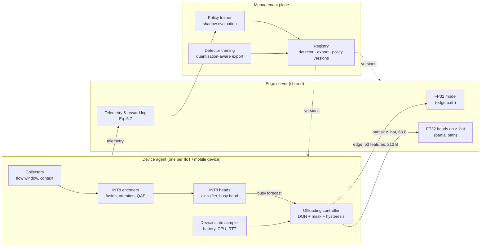
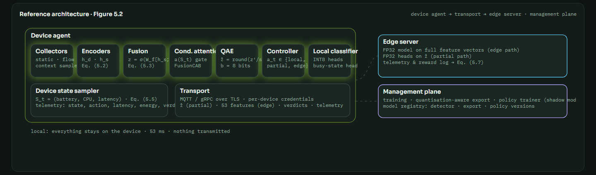
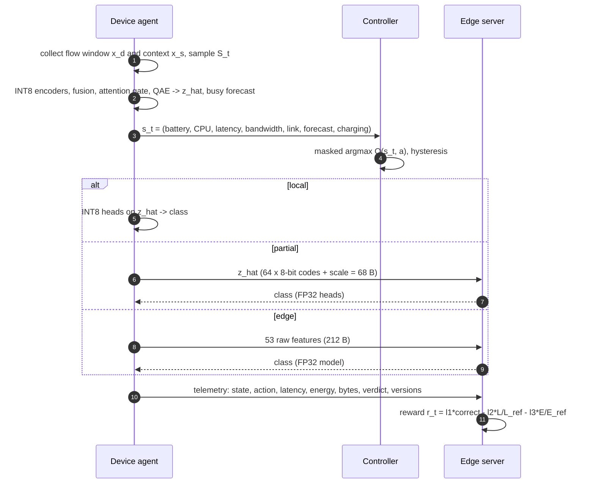
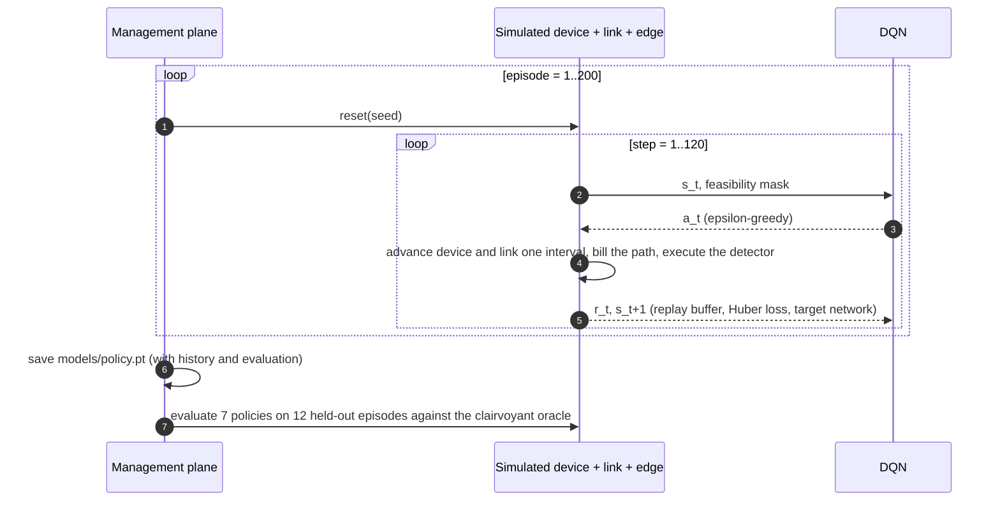

# System architecture

This document describes the roles of the prototype, the three request paths, controller training and operation, telemetry and versioning, and the HTTP API. It follows the reference architecture of thesis Section 5.4.2 (Figure 5.2).

## 1. Roles





| Role | Responsibility | Implementation |
|---|---|---|
| Device agent | Collect the flow window and the context; sample $S_t$; run the INT8 encoder (and the heads on the local path); choose the path; send telemetry | `simulator.DeviceSim`, `NumpyRuntime` (hybrid map), `controller.DQNPolicy` |
| Edge server | Run the FP32 model on raw features (edge path) or the FP32 heads on $\hat z$ (partial path); record per-request state, action, latency, energy, verdict and reward | `NumpyRuntime` (FP32), `Engine._fleet_loop`, `data/telemetry.jsonl` |
| Management plane | Train the detector and the busy head, run the quantisation study and export, train and evaluate the controller, keep the three versions | `Engine._train_worker`, `Engine._after_train`, `Engine._ctl_worker` |
| Dashboard | Inspection, fleet, detector, controller and system views | `web/`, `api.py` |

## 2. The three request paths



The latency and energy of each path are computed by the cost model of [METHODOLOGY.md](METHODOLOGY.md#8-execution-paths-and-cost-model). Detection correctness is computed by actually executing the precision that the path uses.

## 3. Controller training and evaluation



## 4. Module reference

| Module | Main contents |
|---|---|
| `caqedge/data.py` | `FLOW_FEATURES` (46), `CONTEXT_FEATURES` (7), `LABEL_MAP` (34 CIC labels → 8 classes), `load_cic`, `synth_flows`, `DeviceContextSim`, `context_series`, `build_dataset`, cache save/load, `standardise_flow` |
| `caqedge/model.py` | `CAQEdgeNet`, `FakeQuant` (straight-through), `train_model`, `sample_states`, `predict`, `evaluate`, `NumpyRuntime` (per-layer precision, size, latency, accuracy), `layer_table` |
| `caqedge/simulator.py` | `NetworkSim`, `DeviceSim`, `CostModel` (paths, reward, cost), `Env` (one device, one episode) |
| `caqedge/controller.py` | `DQNPolicy`, `QLearningPolicy`, `RandomPolicy`, `RulePolicy`, `CostThresholdPolicy`, `GreedyPolicy`, `train_dqn`, `train_qlearning`, `evaluate_policies` |
| `caqedge/engine.py` | `Engine`: dataset cache, detector training, quantisation study, busy-state baselines, ablation, controller training, live fleet, inspection, status |
| `caqedge/api.py` | FastAPI application; serves the API and the static dashboard |

## 5. Runtime model, persistence and versioning

| Aspect | Implementation |
|---|---|
| Web server | Uvicorn serving a FastAPI app; static dashboard with no build step |
| Background work | Detector training, ablation, controller training and the fleet loop run in daemon threads; the dashboard polls their state |
| Dataset cache | `data/cache/dataset.npz`: raw and standardised flows, context, labels, busy targets, split, standardisation statistics, data source |
| Detector | `models/caq_edgenet.pt`: state dict, architecture configuration, version, learning curve, standardisation statistics |
| Policy | `models/policy.pt`: Q-network, version, training history and the last policy comparison |
| Telemetry | `data/telemetry.jsonl`: one JSON object per request (device, state, action, oracle, shadow action, latency, energy, bytes, reward, label, correctness, versions) |
| Versions | detector `dYYYYMMDD-HHMMSS`, quantised export `qYYYYMMDD-HHMMSS` (derived from the detector), policy `pYYYYMMDD-HHMMSS` |

## 6. HTTP API

All endpoints return JSON. The interactive OpenAPI documentation is served at `/api/docs`.

| Method | Path | Purpose |
|---|---|---|
| GET | `/api/status` | Training flags, versions, model configuration and layers, dataset summary, metrics summary, deployment summary, cost model, fleet snapshot, resources, configuration |
| GET | `/api/events?since=<id>` | Event-log entries newer than `id` |
| GET | `/api/resources` | Process CPU, resident memory, threads, and system CPU and RAM |
| GET | `/api/dataset` | Class distribution (Table 5.2 layout), split, feature names, data source |
| POST | `/api/detector/train` | `{"epochs": 12}`: train the detector, then run the quantisation study |
| GET | `/api/detector/state` | Learning curve, test metrics, busy-state baselines, deployment table, sensitivity, ablation, per-path accuracy |
| POST | `/api/ablation/run` | Train and evaluate the ablation variants |
| POST | `/api/controller/train` | `{"episodes": 200}`: train the DQN and the baselines, then compare them |
| GET | `/api/controller/state` | Episode history, policy comparison, cost-model parameters, policy version |
| POST | `/api/fleet` | `{"enabled": true \| false}`: start or stop the live fleet |
| GET | `/api/fleet/state` | Devices, rolling statistics, recent telemetry |
| GET | `/api/samples` | Test-flow indices per class |
| POST | `/api/inspect` | `{"index": 257, "state": {"battery": 0.2, "cpu": 0.85, "rtt_ms": 30, "bandwidth_mbps": 4, "edge_load": 0.3, "link_up": true}}`; alternatively `{"values": [46 raw flow features], "state": {...}}` |

Example:

```bash
curl -X POST -H "Content-Type: application/json" \
     -d '{"index": 0, "state": {"battery": 0.2, "cpu": 0.85, "rtt_ms": 30, "link_up": true}}' \
     http://127.0.0.1:8767/api/inspect
```

## 7. Extension points

- **Real device measurements.** Replace `CostModel.path` with measured per-path latency and energy (for example from a hardware power monitor), keeping the same return structure.
- **A mobile runtime.** Export the trained `CAQEdgeNet` with the hybrid bit map to ONNX Runtime Mobile, TensorFlow Lite or ExecuTorch. `NumpyRuntime.describe()` gives the per-layer precision.
- **Other controllers.** Implement `Policy.act(features, mask, env)`, for example PPO, and add the policy to the comparison in `Engine._ctl_worker`.
- **Other reward weights.** Change $\lambda_{1,2,3}$ in `config.yaml`. As in thesis Section 5.4.4, re-train and re-evaluate the policy before promoting it.
