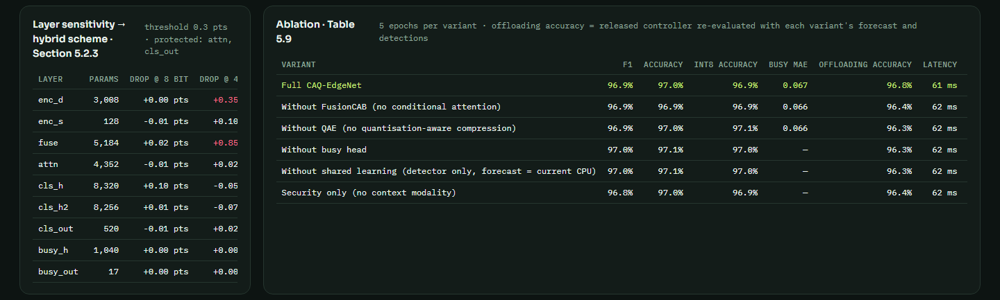
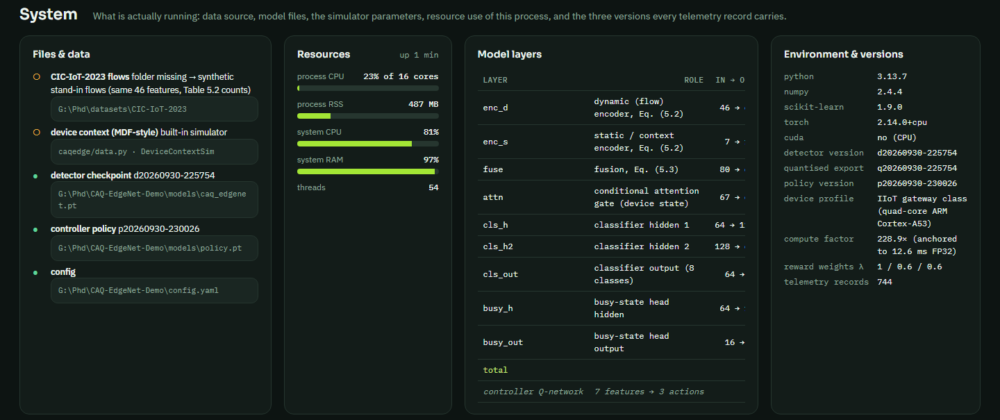

# Evaluation and reproducibility

This document states what is evaluated, how, on which hardware, and what the prototype measured. Two kinds of numbers are kept strictly apart:

- **results of the thesis**, obtained on CIC-IoT-2023 and the MDF context data, and
- **measurements of this prototype**, obtained on a CPU-only machine with the **synthetic stand-in** flows (the CIC-IoT-2023 CSVs were not part of this run), the **simulated** device context and the **simulated** link and edge server.

Sizes and relative accuracies of the precision variants are properties of the model and carry over. Absolute latency, energy and throughput follow the simulator parameters in `config.yaml` and **must not** be compared with thesis Table 5.5.

## 1. Environment

| Item | Value |
|---|---|
| CPU | AMD Ryzen 7 7700, 8 cores / 16 threads |
| Memory | 32 GB |
| GPU | none |
| OS | Windows 11 Pro |
| Software | Python 3.13.7, PyTorch 2.14 (CPU build), NumPy 2.4, scikit-learn 1.9, FastAPI 0.136 |
| Data | synthetic stand-in: 62,451 flows with the class counts of Table 5.2 (1.2 % label noise), split 43,713 / 9,367 / 9,371 (stratified, seed 42) |

## 2. Protocols implemented

| Protocol | What is computed | Code |
|---|---|---|
| Detector training | Per epoch: loss, validation accuracy, macro-F1 and busy-state MAE | `model.train_model` |
| Test evaluation | Accuracy, macro precision, recall and F1, one-vs-rest AUC, per-class metrics, confusion matrix; busy-state MAE, RMSE, MAPE, R² and EVS | `model.evaluate` |
| Busy-state baselines | Last value (current CPU), linear regression and an MLP forecaster on the same context rows | `Engine._busy_baselines` |
| Quantisation study | Per-layer sensitivity at 8 and 4 bits; the hybrid map; FP32, FP16, INT8 and hybrid exports executed for size, measured latency here, device-estimated latency and accuracy | `Engine._after_train` |
| Ablation | Each module removed, retrained for 5 epochs; F1, INT8 accuracy, busy MAE; the released controller re-evaluated with the variant's forecast and detections | `Engine._ablation_worker` |
| Controller comparison | Seven policies on 12 held-out episodes × 120 requests: decision accuracy against the oracle, macro precision, recall and F1 of the decisions, mean latency, energy, cost, throughput, efficiency, action shares | `controller.evaluate_policies` |
| Live fleet | Six devices, rolling window of 300 requests: controller against the shadow rule-based policy, action shares, forecast error, benign-confidence histogram | `Engine._fleet_loop` |

**Decision metrics.** *Decision accuracy* is the share of requests on which the policy chose the oracle's action. The oracle maximises the realised reward and knows jitter, congestion and load in advance, so 100 % is not attainable by a causal policy. *Efficiency* is the mean reward divided by the oracle's mean reward. *Total cost* is $\lambda_2 L / L_{\text{ref}} + \lambda_3 E / E_{\text{ref}}$. *Throughput* is $1000 / \bar L$ requests per second for one device.

## 3. Detector

| Quantity | Value |
|---|---|
| Parameters | 30,825 |
| Training (12 epochs, batch 256) | ≈ 0.28 s per epoch |
| Test accuracy / macro-F1 | 97.15 % / 0.970 |
| Macro precision / recall / AUC (one-vs-rest) | 0.972 / 0.969 / 0.991 |
| Per-class F1 (Benign, DDoS, DoS, Recon, Mirai, Spoofing, Brute Force, Web) | 0.990, 0.953, 0.935, 0.989, 0.989, 0.982, 0.961, 0.963 |

As in real captures, DDoS and DoS are the most confused pair.

## 4. Busy-state forecasting (structure of thesis Table 5.3)

| Method | MAE | RMSE | R² |
|---|---|---|---|
| Last value (current CPU) | 0.0674 | 0.0911 | 0.839 |
| Linear regression | 0.0647 | 0.0827 | 0.867 |
| MLP forecaster (stand-alone) | 0.0644 | 0.0823 | 0.868 |
| **CAQ-EdgeNet busy-state head (shared)** | **0.0645** | **0.0832** | **0.866** |

On the simulated context process, the shared head is as good as the dedicated forecasters and better than the last value. It does not beat them. The thesis reports a clear advantage on the MDF data (MAE 0.061 against 0.072 for a transformer forecaster).

## 5. Deployment precisions (structure of thesis Table 5.7)

| Precision | Model size | Device part (partial path) | Size reduction | Measured here (numpy) | Device estimate | Accuracy |
|---|---|---|---|---|---|---|
| FP32 | 123.3 KB | 50.7 KB | – | 0.041 ms | 12.60 ms | 97.15 % |
| FP16 | 62.5 KB | 25.8 KB | 49.3 % | 0.214 ms | 9.33 ms | 97.15 % |
| INT8 uniform | 32.1 KB | 13.3 KB | 73.9 % | 0.136 ms | 5.41 ms | 97.07 % |
| **INT8 hybrid (QAE, sensitivity-aware)** | **36.4 KB** | **17.6 KB** | **70.5 %** | 0.136 ms | **5.73 ms** | **97.09 %** |

**Hybrid bit widths:** encoders 8, fusion 8, attention 16, classifier hidden layers 8, classifier output 16, busy head 4.

**Layer sensitivity** (accuracy drop in points when only that layer is quantised): at 8 bits every layer is within ±0.1 points. At 4 bits the fusion layer (+0.85) and the flow encoder (+0.35) are the most sensitive.

**Reading.** Hybrid INT8 removes 70 % of the model for a 0.06-point accuracy change. That agrees with the direction of thesis Table 5.7, where 75.9 % smaller costs 0.6 points. The numpy runtime is slower at reduced precision because it has no integer kernels. The *device* column applies the speed-ups of thesis Table 5.7 and is labelled as an estimate on the dashboard.

## 6. Offloading controller (structure of thesis Tables 5.4–5.5)

Twelve held-out episodes × 120 requests per policy (seeds 5000–5011). The oracle's mean reward is 0.280.

| Policy | Decision accuracy | Decision F1 | Latency | Energy | Total cost | Throughput | Efficiency | Local / partial / edge |
|---|---|---|---|---|---|---|---|---|
| Random | 44.0 % | 25.4 % | 96.9 ms | 116.4 mJ | 0.853 | 10.3 req/s | 0.407 | 44 / 28 / 28 % |
| Rule-based | 76.0 % | 35.7 % | 76.8 ms | 112.3 mJ | 0.756 | 13.0 req/s | 0.753 | 75 / 12 / 13 % |
| Cost threshold | 94.0 % | 52.0 % | 64.1 ms | 109.5 mJ | 0.694 | 15.6 req/s | 0.973 | 96 / 0 / 4 % |
| Greedy offloading | 95.2 % | 62.6 % | 64.7 ms | 109.2 mJ | 0.696 | 15.5 req/s | 0.968 | 91 / 0 / 9 % |
| Q-learning (tabular) | 68.8 % | 37.3 % | 76.7 ms | 111.8 mJ | 0.754 | 13.0 req/s | 0.761 | 68 / 15 / 16 % |
| DQN without busy forecast | 95.2 % | 57.0 % | 63.8 ms | 109.3 mJ | 0.692 | 15.7 req/s | 0.981 | 94 / 0 / 6 % |
| **CAQ-EdgeNet controller (DQN + forecast)** | **95.0 %** | **56.2 %** | **63.8 ms** | **109.3 mJ** | **0.693** | **15.7 req/s** | **0.980** | 94 / 0 / 6 % |

**Reading.**

- The learned controller, the cost-threshold policy and the greedy policy clearly beat the rule-based and random policies. Their latency is 17 % below the rule-based policy.
- On this simulator the DQN is on par with the best heuristics. It does not beat them, and the forecast input brings no measurable gain. The best action is mostly determined by the *current* CPU load and link state, which every policy observes.
- The **partial** path is rarely optimal under these parameters. It wins only when the device CPU and the edge load are both high. The Inspect panel shows this with the sliders (for example CPU 85 %, edge load 80 %).
- The thesis reports a clear ordering on the real data (CAQ-EdgeNet 93.8 % > PPO 92.4 % > DQN 91.2 % > rule-based 81.5 %). The prototype provides the machinery to repeat that comparison once the simulator is replaced by measured device and link data.

## 7. Ablation (structure of thesis Table 5.9)

Each variant is retrained for 5 epochs. Offloading accuracy is that of the released controller, re-evaluated with the variant's forecast and detections.



| Variant | F1 | INT8 accuracy | Busy MAE | Offloading accuracy | Total cost |
|---|---|---|---|---|---|
| Full CAQ-EdgeNet | 96.9 % | 96.95 % | 0.068 | 96.8 % | 0.681 |
| Without FusionCAB (conditional attention) | 96.9 % | 96.95 % | 0.066 | 96.4 % | 0.682 |
| Without QAE | 96.9 % | 97.09 % | 0.066 | 96.3 % | 0.682 |
| Without busy head | 97.0 % | 97.01 % | – | 96.3 % | 0.682 |
| Without shared learning (forecast = current CPU) | 97.0 % | 97.01 % | – | 96.3 % | 0.682 |
| Security only (no context modality) | 96.8 % | 96.86 % | – | 96.4 % | 0.682 |

The differences are below one point. The full model has the highest offloading accuracy, by 0.4–0.5 points, but on this data no component is indispensable. The thesis attributes drops of 1.1–4.7 F1 points to the same components on the real datasets. That effect cannot appear with a stand-in whose classes are separable from the flow features alone and whose context is easy to forecast.

## 8. Live fleet

Six devices, a tick of 0.7 s, and a window of the last 300 requests:

| Quantity | Controller (acting) | Rule-based (shadow) |
|---|---|---|
| Mean reward | 0.265 | 0.072 |
| Mean latency | 64.9 ms | 105.9 ms |
| Mean energy | 109.7 mJ | 116.9 mJ |

The window also recorded a detection accuracy of 97.2 %, a busy-forecast MAE of 0.066 and 2 fallbacks to the local path during link outages. The action shares were 95 % local, 0 % partial and 5 % edge.

## 9. Resource consumption



| Quantity | Value |
|---|---|
| Resident memory of the whole system | ≈ 470–490 MB |
| Detector checkpoint / policy file | 132 KB / 42 KB |
| Dataset cache | ≈ 16 MB |
| Controller training (200 episodes + Q-learning + DQN without forecast + comparison) | ≈ 80 s |
| Ablation (6 variants × 5 epochs + controller re-evaluation) | ≈ 11 s |

## 10. Results of the thesis

Obtained on CIC-IoT-2023 and the MDF data, and reported here for reference. They are not produced by this repository.

| Quantity | Value | Source |
|---|---|---|
| Five-fold CV accuracy / precision / recall / F1 / AUC | 96.72 ± 0.35 / 96.60 / 96.46 / 96.50 / 98.50 % | Table 5.8 |
| Offloading accuracy: CAQ-EdgeNet · PPO · DQN · Q-learning · rule-based · random | 93.8 · 92.4 · 91.2 · 89.4 · 81.5 · 33.3 % | Table 5.4 |
| Latency / energy / throughput: adaptive · rule-based · edge only · local only | 72 / 101 / 124 / 185 ms; 2.41 / 3.12 / 3.48 / 4.32 J; 13.9 / 9.9 / 8.1 / 5.4 req/s | Table 5.5 |
| FP32 · FP16 · INT8 size, time, accuracy | 8.7 · 4.5 · 2.1 MB; 12.6 · 9.3 · 5.4 ms; 93.8 · 93.6 · 93.2 % | Table 5.7 |
| Busy-state MAE: CAQ-EdgeNet · transformer · LSTM · linear regression | 0.061 · 0.072 · 0.086 · 0.152 | Table 5.3 |
| Ablation F1: full · without FusionCAB · without QAE · without busy head · without shared learning · security only | 96.1 · 93.7 · 95.0 · 94.2 · 92.6 · 91.4 % | Table 5.9 |

## 11. How to reproduce

```bash
python -m pip install -r requirements.txt
python run.py --no-browser &
curl -X POST -H "Content-Type: application/json" -d '{"epochs": 12}'    http://127.0.0.1:8767/api/detector/train
curl -X POST -H "Content-Type: application/json" -d '{"episodes": 200}' http://127.0.0.1:8767/api/controller/train
curl -X POST http://127.0.0.1:8767/api/ablation/run
curl -X POST -H "Content-Type: application/json" -d '{"enabled": true}' http://127.0.0.1:8767/api/fleet
curl http://127.0.0.1:8767/api/detector/state
curl http://127.0.0.1:8767/api/controller/state
```

**On CIC-IoT-2023.** Place the CSV files in `datasets/CIC-IoT-2023/`, delete `data/cache/dataset.npz` and restart. The header chip then shows `data cic-iot-2023`.

**Determinism.** The data generation, split, model initialisation, controller training and evaluation episodes use fixed seeds. Wall-clock timings vary with machine load.

## 12. Threats to validity

- **Synthetic flows.** The stand-in reproduces the feature names, class counts and typical class signatures of CIC-IoT-2023, but not its real distributions. Accuracy on it is not an estimate of the thesis result.
- **Simulated resources.** Latency and energy come from a parametric cost model. The relative ordering of the paths is plausible, but it is not measured on hardware.
- **Oracle-based decision accuracy.** It measures agreement with a clairvoyant choice. Two policies with equal reward can differ in decision accuracy when several actions are nearly tied.
- **Ablation on 5 epochs.** The variants are trained more briefly than the full model, and their differences are within run-to-run noise on this data.
