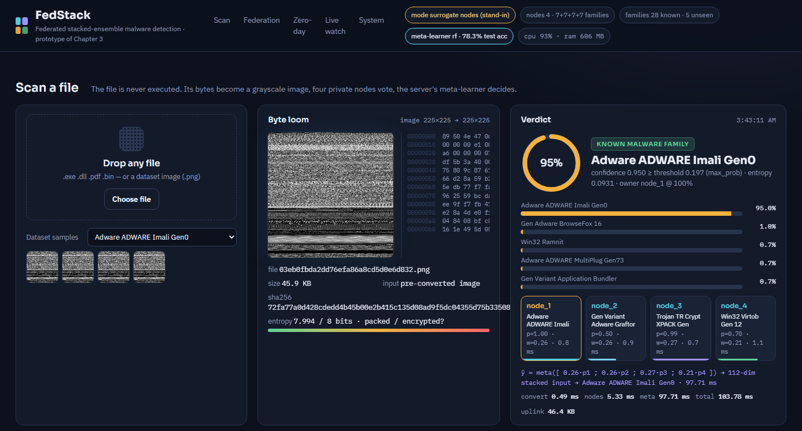
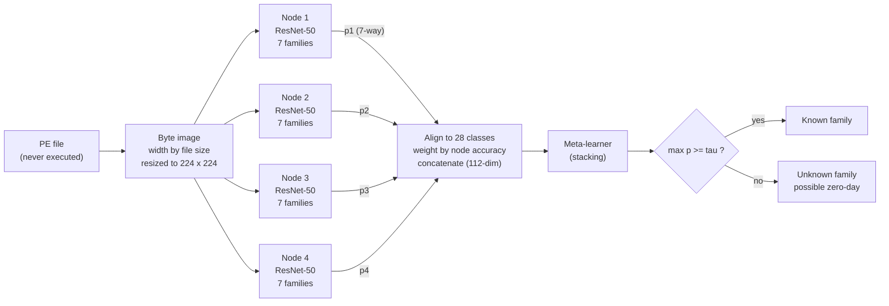
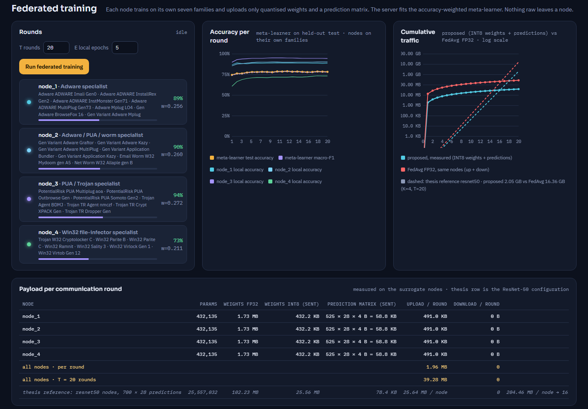
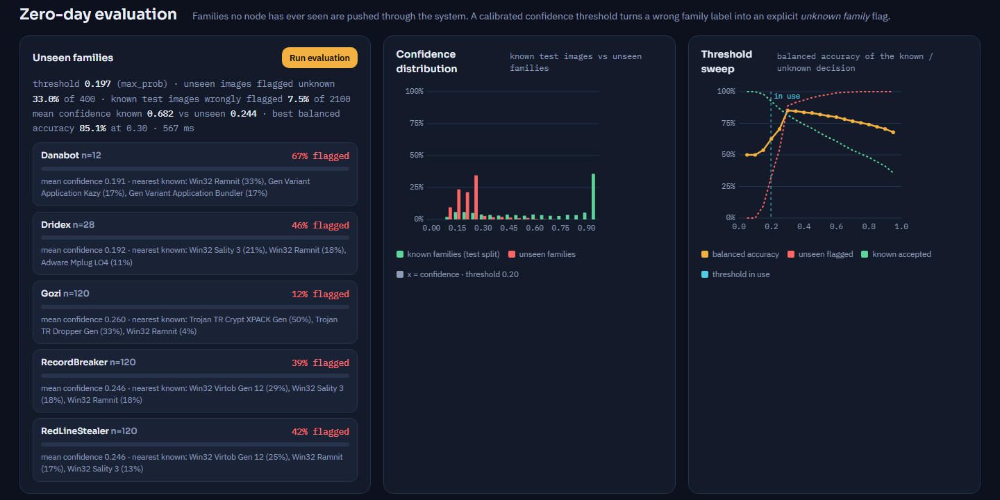

# FedStack-Prototype

**A runnable system prototype of the federated stacked-ensemble framework for zero-day malware detection on byte images**

[](requirements.txt)
[](LICENSE)
[](https://doi.org/10.1371/journal.pone.0339907)
[](https://doi.org/10.6084/m9.figshare.29107697)
[](#citation)



---

## Overview

Zero-day malware is hard to classify for two structural reasons. First, the number of families is large and their class distribution is highly imbalanced. Second, families overlap: packers and shared code produce strong inter-class similarity, while polymorphism produces large intra-class variation. Organisations that hold malware corpora also cannot always pool them, for legal or confidentiality reasons.

The framework addresses both problems with a **federated stacked ensemble** (*FedStack*):

1. Every Portable Executable (PE) file is represented as a **grayscale image** of its raw bytes. The image width is chosen from the file size, following Nataraj et al.
2. Each participating organisation is a **node** that fine-tunes its own convolutional network (ResNet-50 in the thesis configuration) on its own **class-specialist** subset of the families. Raw samples never leave the node.
3. The server does **not** average parameters as FedAvg does. It **stacks** the nodes' soft-max outputs. The outputs are aligned into a global class space and scaled by an **accuracy-aware node weight**, and a **meta-learner** is trained on the stacked vector.
4. A confidence threshold calibrated on known data turns the closed-set meta-learner into an **open-set** detector. Files whose confidence falls below the threshold are reported as an **unknown family (possible zero-day)** and are not forced into the nearest known family.

This repository contains the **system prototype** of that framework. It is an end-to-end, runnable implementation with an endpoint agent, an aggregation server, four nodes and an analyst dashboard. It was built for the design-and-deployment chapter of the PhD thesis, and every number on the dashboard is measured by the running process.

The prototype runs on a CPU-only machine. It switches automatically to the trained ResNet checkpoints of the research code as soon as they are placed in `models/`. Until then it uses clearly labelled *stand-in* nodes, so the whole system can be demonstrated without a GPU.

> **Relation to the research code.** The experiments of the paper were run with the research code at [github.com/jhshah101/Zero-Day-Malware-Detection](https://github.com/jhshah101/Zero-Day-Malware-Detection) (`train_node.py`, `server_stack.py`). This prototype loads the checkpoints that code writes, without modification. It adds everything a deployed system needs around the model: the serving path, open-set decisions, payload accounting, an endpoint watcher, resource measurement and a dashboard.

## What the prototype demonstrates

| Capability | Where it is implemented | Thesis reference |
|---|---|---|
| Bytes → grayscale image (width rule), entropy and a minimal PE-header reader; the file is never executed | [`fedstack/imaging.py`](fedstack/imaging.py) | Section 3.2 |
| Four class-specialist nodes (4 × 7 of 28 families), ResNet-50/18 or AlexNet checkpoints, or CPU stand-ins | [`fedstack/models.py`](fedstack/models.py), [`fedstack/surrogate.py`](fedstack/surrogate.py) | Sections 3.3, 3.5.1 |
| Class alignment, accuracy-aware weighting (Eq. 3.15), stacking meta-learner (random forest or logistic regression) | [`fedstack/engine.py`](fedstack/engine.py) | Section 3.4 |
| Synchronous federated rounds (T rounds × E local epochs) with per-round payload accounting against FedAvg | `Engine.run_federation`, `Engine.payload_round` | Section 3.5.1, Table 3.12 |
| Open-set decision with a threshold calibrated out-of-fold on known data (false-alarm budget β) | `Engine._calibrate_threshold` | Section 3.6.6, Eq. 3.17 |
| Zero-day evaluation on five families unseen by every node (Danabot, Dridex, Gozi, RecordBreaker, RedLine Stealer) | `Engine.zero_day_eval` | Sections 3.5.6, 3.6.6 |
| Endpoint agent: folder watcher, optional quarantine, verdict history | `Engine.set_watch` | Section 3.6.7 |
| Resource monitor: CPU, resident memory, model sizes in FP32/FP16/INT8 | `Engine.resources`, `models.state_dict_bytes` | Section 3.6.8 |

## Method at a glance



The formal description, with equations, algorithms and the rationale behind every design decision, is in [docs/METHODOLOGY.md](docs/METHODOLOGY.md).

## Quick start

**Requirements.** Python 3.10 or newer. A GPU is not needed.

```bash
git clone <this-repository-url> FedStack-Prototype
cd FedStack-Prototype
python -m pip install -r requirements.txt
```

**Data.** Download the image dataset of the paper from FigShare ([doi:10.6084/m9.figshare.29107697](https://doi.org/10.6084/m9.figshare.29107697)). Place the 28 family folders under `datasets/Short_Dataset/`. Optionally, place families that were never used in training under `datasets/External/`. [docs/DATASETS.md](docs/DATASETS.md) describes the expected layout.

```bash
python scripts/prepare_data.py      # once: builds data/cache (64-px thumbnails, fixed split) and data/samples
python run.py                       # starts the server and opens http://127.0.0.1:8765
```

**First steps on the dashboard.**

1. Open **Federated training** and press *Run federated training*. The default is 20 rounds × 5 local epochs, which takes about 1.5 minutes with the stand-in nodes.
2. Open **Zero-day evaluation** and press *Run evaluation*.
3. Drop any file on **Scan a file**, or click a dataset sample. Executables are read as bytes only and are never executed.

The HTTP API is documented interactively at `http://127.0.0.1:8765/api/docs`.

## Using the trained ResNet checkpoints

1. Train the four nodes with the research code (`train_node.py`). A Colab-ready wrapper that uses the same 4 × 7 partition is provided in [`scripts/colab_train_nodes.py`](scripts/colab_train_nodes.py).
2. Copy `node_1_model.pt … node_4_model.pt` into `models/`. Optionally, also copy `stacker.joblib` written by `server_stack.py`.
3. Leave `mode: auto` in [`config.yaml`](config.yaml) and restart. The header chip changes from *surrogate nodes* to *ResNet-50 checkpoints*.

Each checkpoint is a dictionary with the keys `state_dict`, `class_to_idx`, `backbone`, `grayscale` and `n_classes`. [`scripts/make_test_checkpoint.py`](scripts/make_test_checkpoint.py) writes random-weight checkpoints in that format so the ResNet code path can be tested without trained models. [models/README.md](models/README.md) has the details.

## Dashboard

| Panel | What it shows |
|---|---|
| **Scan a file** | Byte loom (bytes woven into the image), hex view, entropy, PE header and sections. Then the four node votes, the stacked verdict with top-5 families, the open-set decision and per-stage timings. |
| **Federation map** | Endpoint, server and nodes, with animated packets and their sizes. |
| **Federated training** | Per-round meta-learner accuracy and macro-F1, node accuracies, accuracy-aware weights, cumulative traffic against FedAvg, and a per-node payload table. |
| **Zero-day evaluation** | Unseen families flagged as unknown, false alarms on known families, confidence histograms and a threshold sweep. |
| **Live watch** | Endpoint agent that scans every file written into `watch_inbox/`, with optional quarantine. |
| **System** | Model files found, process CPU and memory, node model sizes and software versions. |

<table>
<tr><td></td></tr>
<tr><td></td></tr>
</table>

## Results

### Reported in the paper and thesis (trained ResNet nodes, GPU training)

| Quantity | Value | Source |
|---|---|---|
| Accuracy of the proposed federated stacked ensemble, private dataset (28 families), ResNet-50 nodes | 97.80 % | Thesis Table 3.11 |
| Zero-day detection rate / F1 on held-out families, proposed ensemble | 94.6 % / 0.91 | Thesis Section 3.5.6, Table 3.6 |
| Best non-federated baseline (ResNet-50 features, quadratic SVM), 28 families | 94.80 % | Thesis Table 3.5 |
| Upload per node and round (INT8 weights + prediction matrix) vs FedAvg FP32 | 25.6 MB vs 204.5 MB (8.0× less) | Thesis Table 3.12 |

### Measured on this prototype (AMD Ryzen 7 7700, no GPU)

The accuracy figures below come from the **stand-in nodes** and are **not** the thesis results. The cost figures come from ResNet-50 checkpoints of the released format. Latency, size and memory do not depend on the trained weight values.

| Quantity | Stand-in nodes | Four ResNet-50 nodes |
|---|---|---|
| Meta-learner test accuracy / macro-F1 after 20 rounds | 78.3 % / 0.779 | requires trained checkpoints |
| End-to-end scan latency (CPU) | ≈ 52–100 ms | ≈ 91–94 ms (logistic stacker), ≈ 118–126 ms (random forest) |
| Upload per round, four nodes | 1.96 MB (7.0× below FedAvg) | 95.2 MB (7.9× below FedAvg) |
| Unseen families flagged unknown / known false alarms (β = 0.10) | 33.0 % / 7.5 % | requires trained checkpoints |
| Resident memory of the whole system | ≈ 600 MB | ≈ 1.0 GB |

The full protocol, all tables and instructions for reproducing every number are in [docs/EVALUATION.md](docs/EVALUATION.md).

## Repository structure

```
FedStack-Prototype/
├── config.yaml              every path, the node partition, federation, open-set and watcher settings
├── run.py                   launcher (uvicorn + browser)
├── fedstack/
│   ├── imaging.py           bytes → image, entropy, PE-header reader
│   ├── models.py            EmbeddingNet (as in the research code), checkpoint loader, payload sizes
│   ├── surrogate.py         CPU stand-in node (PCA feature extractor + neural head)
│   ├── engine.py            nodes, alignment, weighting, meta-learner, rounds, scanning, zero-day, watcher
│   ├── api.py               FastAPI endpoints
│   └── config.py            configuration loading
├── web/                     dashboard (HTML/CSS/JS, no build step)
├── scripts/
│   ├── prepare_data.py      builds the thumbnail cache and demo samples
│   ├── colab_train_nodes.py trains the four ResNet nodes with the research code
│   └── make_test_checkpoint.py  random-weight checkpoints for testing the loader
├── datasets/                place the image dataset here (not versioned)
├── models/                  place trained checkpoints here (not versioned)
└── docs/                    methodology, architecture, evaluation, datasets, configuration
```

## Documentation

| Document | Content |
|---|---|
| [docs/METHODOLOGY.md](docs/METHODOLOGY.md) | Problem formulation, byte imaging, node training, stacking with accuracy-aware weights, open-set calibration, payload model, design rationale, complexity |
| [docs/ARCHITECTURE.md](docs/ARCHITECTURE.md) | Components, data flow, sequence of a scan and of a federated round, threading, persistence, HTTP API |
| [docs/EVALUATION.md](docs/EVALUATION.md) | Evaluation protocols, metrics, measured results, reproduction steps, threats to validity |
| [docs/DATASETS.md](docs/DATASETS.md) | Datasets, expected folder layout, preparation pipeline, licensing and ethics |
| [docs/CONFIGURATION.md](docs/CONFIGURATION.md) | Every key of `config.yaml` |

## Limitations

- **Families only.** The training data contain malware families only. The system names the family of a suspicious file and flags unknown families, but it cannot certify a file as benign.
- **No kernel hook.** The endpoint agent polls a folder. Blocking a file before it executes would require a kernel-level file-system filter.
- **Single machine.** All roles run in one process on one machine. The multi-host deployment and its real network latency have not been measured.
- **Stand-in accuracy.** Accuracy and open-set numbers obtained with the stand-in nodes demonstrate the mechanism. They are not estimates of the thesis model.

## Responsible use

The prototype never executes the files it analyses. It reads them as bytes. The dataset consists of **images** derived from malware, not of malware binaries. Do not upload live malware to shared machines. Handle any real samples inside an isolated analysis environment, in accordance with your institution's policy.

## Citation

If you use this software, please cite the article:

```bibtex
@article{ishfaq2026fedstack,
  title   = {A distributed framework for zero-day malware detection using federated ensemble models},
  author  = {Ishfaq, Hassan and Shah, Jamal Hussain and Saleem, Rabia and Afzal, Maira},
  journal = {PLOS ONE},
  volume  = {21},
  number  = {1},
  pages   = {e0339907},
  year    = {2026},
  doi     = {10.1371/journal.pone.0339907}
}
```

and, for the system prototype and its evaluation, the thesis:

```bibtex
@phdthesis{ishfaq2026thesis,
  title  = {Novel Way to Detect Known and Unknown Malware Attacks Prediction and Classification using Machine Learning},
  author = {Ishfaq, Hassan},
  school = {COMSATS University Islamabad, Wah Campus},
  year   = {2026},
  note   = {Chapter 3}
}
```

Machine-readable metadata is in [CITATION.cff](CITATION.cff).

## License and acknowledgements

This software is released under the [MIT License](LICENSE). The dataset is distributed separately under its own terms (see [docs/DATASETS.md](docs/DATASETS.md)).

The work was carried out at the Department of Computer Science, COMSATS University Islamabad, Wah Campus, under the supervision of Dr. Jamal Hussain Shah and the co-supervision of Dr. Saeed ur Rehman.

**Companion repositories** of the same thesis: *SigStack-Prototype* (Chapter 4, multi-antivirus behavioural signatures with transformer encoders) and *CAQ-EdgeNet-Prototype* (Chapter 5, adaptive malware detection on Industrial IoT edge devices).
