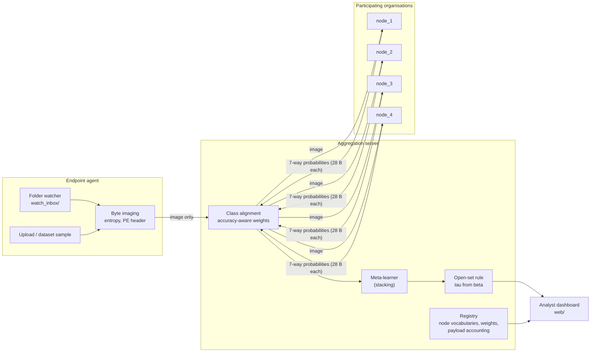
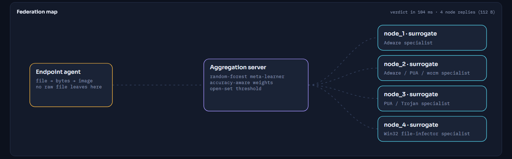
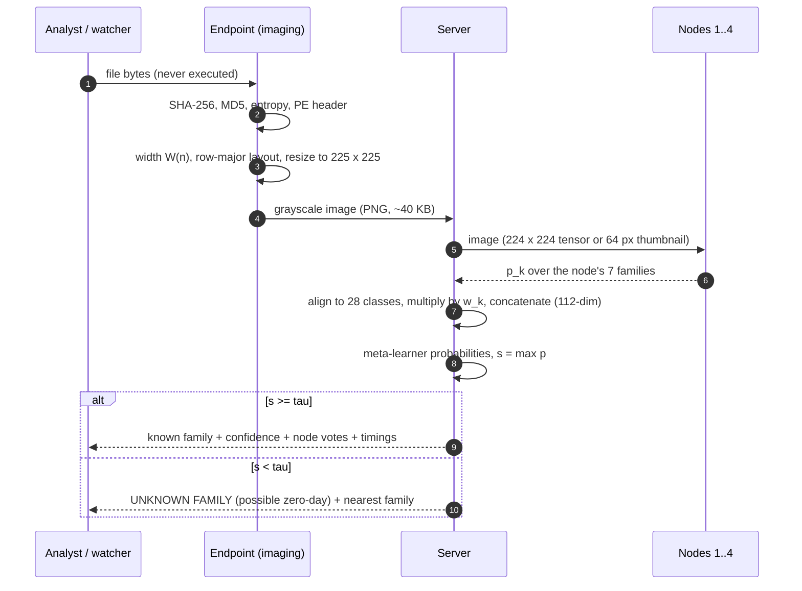
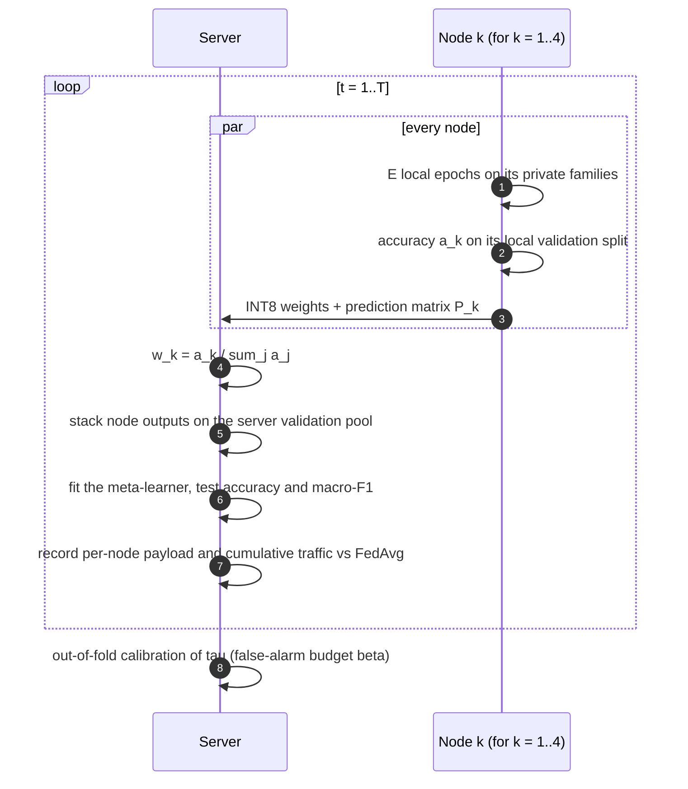

# System architecture

This document describes the components of the prototype, the path of a file through it, the federated round, the runtime model and the HTTP API.

## 1. Roles

The prototype implements the four roles of the reference architecture of thesis Section 3.6.2. For demonstration they share one process; each role is a separate class with a narrow interface, so it can be moved to its own host or container.





| Role | Responsibility | Module / class |
|---|---|---|
| Endpoint agent | Receives files (upload, sample, watched folder), computes hashes, entropy and PE metadata, turns bytes into an image, sends only the image | `imaging.py`, `Engine.scan_bytes`, `Engine._watch_loop` |
| Node | Holds a private model for its seven families and returns a probability vector over its local classes | `NodeRuntime` → `ResNetRuntime` (checkpoint) or `SurrogateRuntime` (stand-in) |
| Aggregation server | Aligns node outputs to the global vocabulary, applies the node weights, runs the meta-learner and the open-set rule, keeps the registry and the payload accounting | `Engine.align`, `Engine.stack_features`, `Engine.fit_meta`, `Engine.payload_round` |
| Analyst dashboard | Read-only views of all of the above, plus the controls for rounds, evaluation and the watcher | `web/index.html`, `web/app.js`, `api.py` |

## 2. Path of one file



Each stage is timed separately (`describe`, `convert`, `nodes`, `meta`, `total`). The dashboard shows the timings with every verdict. The measured latency budget is in [EVALUATION.md](EVALUATION.md#3-latency-of-one-scan).

## 3. Federated round



Rounds run in a background thread (`Engine._federation_worker`). The dashboard polls `/api/federation/state` for the progress, the per-round history and the payload table. With the stand-in nodes, every round is real local training. With ResNet checkpoints, the node side has already run offline on a GPU, and the server side is replayed once.

## 4. Module reference

| Module | Main contents |
|---|---|
| `fedstack/config.py` | `Config`: YAML loading, dotted-key access, path resolution relative to the repository, and a sanitised summary for the UI |
| `fedstack/imaging.py` | `image_width_for`, `bytes_to_image`, `to_backbone_array`, `to_thumbnail`, `shannon_entropy`, `hashes`, `hex_preview`, `parse_pe`, `describe_bytes` |
| `fedstack/models.py` | `get_backbone` and `build_embedding_net` (identical to the research code), `load_node_checkpoint`, and `state_dict_bytes` for FP32, FP16 and INT8 serialised sizes |
| `fedstack/surrogate.py` | `SurrogateNode`: per-node StandardScaler + PCA feature extractor, MLP head trained with `partial_fit`, payload and persistence |
| `fedstack/engine.py` | `Engine`: boot (mode selection, cache, state restore), node runtimes, alignment, weights, meta-learner, calibration, rounds, scanning, zero-day evaluation, watcher, resources, status |
| `fedstack/api.py` | FastAPI application; serves the API and the static dashboard |
| `run.py` | Command-line launcher (`--config`, `--host`, `--port`, `--no-browser`) |

### Mode selection at start-up

```
mode = config.mode                                    # auto | resnet | surrogate
if mode == "resnet" or (mode == "auto" and every node checkpoint exists):
    load the checkpoints (fall back to surrogate on error)
    load models/stacker.joblib if present, else fit the meta-learner in the federation panel
else:
    build the stand-in nodes from the thumbnail cache
    restore data/cache/state_surrogate.pkl if a previous run saved one
```

## 5. Runtime model and persistence

| Aspect | Implementation |
|---|---|
| Web server | Uvicorn serving a FastAPI app; the dashboard is static HTML/CSS/JS with no build step |
| Concurrency | Federated rounds and the folder watcher run in daemon threads; scans take a re-entrant lock so that a scan never sees a half-updated meta-learner |
| Event log | In-memory ring buffer of 2,000 events, polled by the dashboard (`/api/events?since=id`) |
| Persistence | `data/cache/thumbs64.npz` (thumbnails, labels and the fixed split); `data/cache/state_surrogate.pkl` (trained stand-in nodes, meta-learner, weights, threshold, history); the checkpoints in `models/` |
| Safety | Files are only read. Quarantine *moves* flagged files to `quarantine/` and never deletes them. Sample paths are resolved and checked to stay inside `data/samples` (no path traversal) |

## 6. HTTP API

All endpoints return JSON. The interactive OpenAPI documentation is served at `/api/docs`.

| Method | Path | Purpose |
|---|---|---|
| GET | `/api/status` | Mode, readiness, nodes (families, accuracy, weight, model info), meta-learner metrics, threshold, cache, resources, versions, configuration summary, recent scans, current payload |
| GET | `/api/events?since=<id>` | Event-log entries newer than `id` |
| GET | `/api/resources` | Process CPU, resident memory, threads, and system CPU and RAM |
| POST | `/api/scan` | Multipart upload (`file`, at most 64 MB). Returns file metadata, hex preview, the image as base64 PNG, node votes, verdict, open-set decision, timings and payload |
| GET | `/api/samples` | Demo images of known and unseen families |
| GET | `/api/samples/file/{path}` | One demo image |
| POST | `/api/scan_sample` | `{"path": "known/<family>/<file>.png"}`: scan a demo image |
| POST | `/api/federation/run` | `{"rounds": T, "epochs": E}`: start the federated rounds in the background |
| GET | `/api/federation/state` | Running flag, progress, per-round history, meta-learner metrics, threshold, payload, node accuracies |
| POST | `/api/zeroday/run` | Recalibrate the threshold and evaluate the unseen families against the known test split |
| GET | `/api/zeroday/state` | Last zero-day result: per-family flag rate, nearest known families, histograms, sweep |
| POST | `/api/watch` | `{"enabled": true \| false}`: start or stop the folder watcher |

Example:

```bash
curl -F "file=@some_sample.bin" http://127.0.0.1:8765/api/scan
```

## 7. Extension points

- **Another backbone.** Add it to `get_backbone`, together with `BACKBONE_PARAMS` and `BACKBONE_GMACS`, then set `model.backbone`.
- **More nodes or a different partition.** Edit `model.nodes` and `federation.partition`. The meta-learner input dimension ($K \cdot C$) follows automatically.
- **A different open-set score.** Implement it in `Engine._confidence` and select it with `open_set.method`.
- **A multi-host deployment.** The engine's node interface is `predict_proba(batch) -> probabilities` plus `payload()`. A remote node is a thin HTTP or gRPC client that implements the same two methods.
