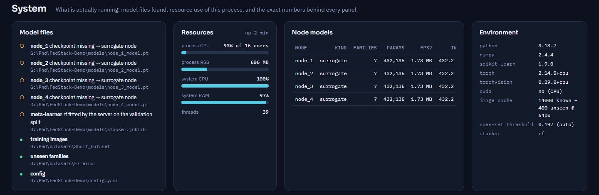

# Evaluation and reproducibility

This document states what is evaluated, how, on which hardware, and what the prototype measured. It keeps two kinds of numbers strictly apart:

- **results of the paper and thesis**, obtained with fine-tuned ResNet nodes trained on GPUs, and
- **measurements of this prototype**, obtained on a CPU-only machine. Accuracy figures here come from the **stand-in nodes** (Section 11 of [METHODOLOGY.md](METHODOLOGY.md)). Cost figures come from **ResNet-50 checkpoints of the released format**.

Latency, model size, payload and memory do not depend on the values of the trained weights, so the cost measurements carry over to the trained model. The accuracy measurements do not.

## 1. Environment

| Item | Value |
|---|---|
| CPU | AMD Ryzen 7 7700, 8 cores / 16 threads |
| Memory | 32 GB |
| GPU | none |
| OS | Windows 11 Pro |
| Software | Python 3.13.7, NumPy 2.4, scikit-learn 1.9, PyTorch 2.14 (CPU build), torchvision 0.29, FastAPI 0.136 |
| Data | the 14,000 training images of the paper (28 families × 500 PNG, 225 × 225 grayscale), re-split per family into 350 train / 75 validation / 75 test with seed 42; 400 images of five families unseen by every node |

The GPUs used for the thesis experiments were a Google Colab T4, a Colab L4, a Colab A100 40 GB and a laboratory RTX 3090.

## 2. Protocols implemented

| Protocol | What is computed | Code |
|---|---|---|
| **Federated training** | $T$ rounds × $E$ local epochs; after every round the node accuracies on their own families, the accuracy-aware weights, and the meta-learner's test accuracy and macro-F1 on the held-out split | `Engine._federation_surrogate` |
| **Payload accounting** | Per node and round: parameters, FP32 and INT8 serialised weights, prediction-matrix bytes, upload and download, the FedAvg FP32 equivalent; cumulative traffic over $T$ rounds | `Engine.payload_round`, `models.state_dict_bytes` |
| **Open-set calibration** | $\tau$ as the $\beta$-quantile of out-of-fold confidences on the known validation pool | `Engine._calibrate_threshold`, `Engine.recalibrate` |
| **Zero-day evaluation** | For every unseen family: share flagged as unknown at $\tau$, mean confidence, nearest known families. For the known test split: the false-unknown rate. Confidence histograms of both populations, and a sweep of the balanced accuracy of the known/unknown decision | `Engine.zero_day_eval` |
| **Latency** | Per-stage wall-clock time of every scan | `Engine.scan_bytes` |
| **Resources** | Process CPU, resident memory and threads; model sizes per precision | `Engine.resources` |

### Metrics

- **Accuracy** $= \frac{1}{N}\sum_i \mathbb{1}[\hat{y}_i = y_i]$ on the held-out test split (2,100 images, 75 per family).
- **Macro-F1** $= \frac{1}{C}\sum_c \frac{2 P_c R_c}{P_c + R_c}$. Every family counts equally, which matters under class imbalance.
- **Flagged unknown** (unseen families) $= \frac{1}{|U|}\sum_{x \in U}\mathbb{1}[s(x) < \tau]$, which is the true-positive rate of the zero-day decision.
- **False-unknown rate** (known families) $= \frac{1}{|K|}\sum_{x \in K}\mathbb{1}[s(x) < \tau]$, which is the false alarms the analyst must review.
- **Balanced accuracy** of the known/unknown decision $= \tfrac{1}{2}\,(\text{flagged unknown} + (1 - \text{false-unknown rate}))$.

## 3. Latency of one scan

Median of seven scans per configuration. Nodes are evaluated sequentially on the CPU.

| Stage | Stand-in nodes | Four ResNet-18 nodes | Four ResNet-50 nodes |
|---|---|---|---|
| Static metadata (hashes, entropy, PE header) | ≈ 1–2 ms | ≈ 0.3 ms | ≈ 0.2 ms (image), ≈ 2 ms (360 KB PE file) |
| Bytes → image and thumbnail | ≈ 8–23 ms | ≈ 8 ms | ≈ 0.4–0.7 ms |
| Four node inferences | ≈ 4–5 ms | ≈ 62 ms | ≈ 89–97 ms (≈ 23 ms per node) |
| Alignment, weighting, meta-learner (random forest) | ≈ 39–42 ms | ≈ 40 ms | ≈ 26–27 ms (0.3 ms with logistic regression) |
| **End-to-end verdict** | **≈ 52–70 ms** | **≈ 111 ms** | **≈ 118–126 ms** (≈ 91–94 ms with logistic regression) |
| Uplink per scan (PNG image) | ≈ 46 KB | ≈ 46 KB | ≈ 40–43 KB |
| Node replies per scan | 4 × 28 B | 4 × 28 B | 4 × 28 B |

**Reading.** Inference does not need a GPU. Four convolutional nodes evaluated one after another still return a verdict in about a tenth of a second. The random-forest stacker costs as much as one or two convolutional nodes. The logistic-regression stacker of the thesis reduces that stage to 0.3 ms, which is why it is the recommended production setting (`model.stacker: logreg`).

## 4. Communication per round

| Configuration | Parameters per node | Weights FP32 | Weights INT8 (sent) | Prediction matrix (sent) | Upload per node | FedAvg FP32 per node (up + down) |
|---|---|---|---|---|---|---|
| Stand-in node (measured) | 432,135 | 1.73 MB | 432.2 KB | 525 × 28 × 4 B = 58.8 KB | 491.0 KB | 3.46 MB |
| ResNet-50 node, seven-way head (measured) | 23,569,223 | 94.38 MB | 23.75 MB | 58.8 KB | 23.81 MB | 188.75 MB |
| ResNet-50, closed form (thesis Table 3.12; 1,000-way head, 700 validation images) | 25,557,032 | 102.23 MB | 25.56 MB | 78.4 KB | 25.64 MB | 204.46 MB |

| Totals, four nodes | One round | Twenty rounds | Reduction vs FedAvg FP32 |
|---|---|---|---|
| Stand-in nodes | 1.96 MB | 39.3 MB | 7.0× |
| ResNet-50 nodes (measured) | 95.2 MB | 1.90 GB | 7.9× |
| ResNet-50 closed form | 102.6 MB | 2.05 GB | 8.0× |

The measured ResNet-50 row lies about 7 % below the closed form. The deployed node carries a seven-way head instead of the 1,000-way ImageNet classifier, and it holds 525 validation images rather than 700. The closed form is therefore a conservative bound.

## 5. Federated training with the stand-in nodes

Twenty rounds of five local epochs each; random-forest meta-learner; β = 0.10.

| Quantity | Value |
|---|---|
| Meta-learner test accuracy | **78.3 %** |
| Meta-learner test macro-F1 | **0.779** |
| Node accuracy on its own families (node_1 / 2 / 3 / 4) | 88.8 % / 90.3 % / 94.5 % / 73.3 % |
| Accuracy-aware weights (node_1 / 2 / 3 / 4) | 0.256 / 0.260 / 0.272 / 0.211 |
| Duration of one round (local training of 4 nodes + meta-learner fit), median | 4.6 s |
| Meta-learner fit on the validation pool (2,100 × 112) | 0.83 s |

These numbers show that the pipeline works. The stand-in feature extractor is a PCA of 64-pixel thumbnails, not a fine-tuned ResNet-50. For the accuracy of the framework, see the thesis results below.

## 6. Zero-day evaluation with the stand-in nodes

Calibrated threshold τ = 0.197 (β = 0.10, out-of-fold on the known validation pool).

| Family (unseen by every node) | Images | Flagged unknown | Mean confidence | Nearest known family (share) |
|---|---|---|---|---|
| Danabot | 12 | 66.7 % | 0.191 | Win32 Ramnit (33 %) |
| Dridex | 28 | 46.4 % | 0.192 | Win32 Sality 3 (21 %) |
| Gozi | 120 | 11.7 % | 0.260 | Trojan TR Crypt XPACK Gen (50 %) |
| RecordBreaker | 120 | 39.2 % | 0.246 | Win32 Virtob Gen 12 (29 %) |
| RedLine Stealer | 120 | 41.7 % | 0.246 | Win32 Virtob Gen 12 (25 %) |
| **All unseen families** | **400** | **33.0 %** | **0.244** | |
| Known families (test split) | 2,100 | 7.5 % (false alarms) | 0.682 | |

The best balanced accuracy of the sweep is 85.1 %, at τ = 0.30.

**Reading.** The confidence separates the two populations: the mean is 0.682 for known families and 0.244 for unseen ones. The false-alarm rate on known families (7.5 %) stays within the budget β = 10 %, as the calibration intends. Families whose byte layout resembles a training family are flagged less often, as with Gozi, whose images are mostly attributed to the packed *Crypt XPACK* family. This is the expected blind spot of an image-based detector, and it motivates the behavioural view of Chapter 4.

## 7. Resource consumption



| Quantity | Value |
|---|---|
| Resident memory, whole system (server + 4 stand-in nodes + dashboard) | ≈ 600 MB |
| Resident memory with four ResNet-50 nodes loaded | ≈ 1,022 MB (+514 MB for the four models) |
| Loading four ResNet-50 checkpoints | 2.1 s |
| Process CPU, idle (serving the dashboard) | ≈ 1–2 % of one core |
| Process CPU during a round | ≈ 228 % (2–4 cores) |
| Threads | ≈ 34–37 |
| Threshold calibration (five-fold, out-of-fold) | ≈ 3–4 s, once per federation |
| Zero-day evaluation (2,500 images through 4 nodes and the meta-learner) | ≈ 0.5 s |
| Image cache of the demonstration data | 34 MB |

## 8. Results of the paper and thesis

The following were obtained by the research code with fine-tuned nodes and are reported here for reference. They are not produced by this repository.

| Quantity | Value | Source |
|---|---|---|
| Proposed federated stacked ensemble, private dataset (28 families), ResNet-50 nodes | 97.80 % accuracy | Thesis Table 3.11 |
| Same, Inception-V3 nodes | 98.20 % accuracy | Thesis Table 3.11 |
| Zero-day families held out (Adware: Graftor, Kazy, BrowseFox; Trojan: Zbot, Agent; Worm: Mydoom), proposed ensemble | 94.6 % detection rate, F1 0.91 | Thesis Section 3.5.6, Table 3.6 |
| Baseline ResNet-50 features + quadratic SVM | 94.80 % accuracy | Thesis Table 3.5 |

## 9. How to reproduce

```bash
python -m pip install -r requirements.txt
python scripts/prepare_data.py                  # thumbnail cache + fixed split (seed 42)
python run.py --no-browser &                    # or open the dashboard

# federated training (20 x 5), then zero-day evaluation
curl -X POST -H "Content-Type: application/json" -d '{"rounds": 20, "epochs": 5}' http://127.0.0.1:8765/api/federation/run
curl http://127.0.0.1:8765/api/federation/state      # repeat until "running": false
curl -X POST http://127.0.0.1:8765/api/zeroday/run
```

**With ResNet-50 cost only (random weights).**

```bash
python scripts/make_test_checkpoint.py --backbone resnet50 --out models
python run.py
```

This reproduces the latency, payload and memory columns of Sections 3, 4 and 7.

**With the trained thesis nodes.** Place the four checkpoints (and optionally `stacker.joblib`) in `models/`. The same panels then report the accuracy and the zero-day behaviour of the trained model.

**Determinism.** The data split, PCA and MLP heads use seed 42 (`surrogate.seed`). The random forest uses `random_state=0`. Timings vary with machine load.

## 10. Threats to validity

- **Stand-in accuracy is not model accuracy.** The accuracy-related numbers of Sections 5 and 6 characterise the mechanism, not the fine-tuned ResNet-50 federation.
- **Single-machine measurements.** All roles run in one process. Real network latency between hosts, and straggler effects in synchronous rounds, are not included.
- **Small unseen families.** Danabot (12 images) and Dridex (28 images) are small, so their flag rates have wide confidence intervals.
- **Threshold transfer.** τ is calibrated per federation. It must be recalibrated whenever nodes, families or backbones change.
