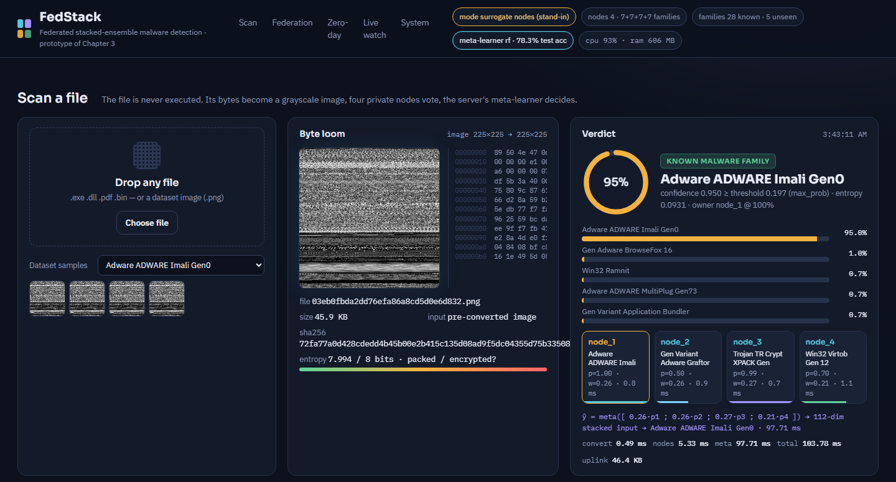
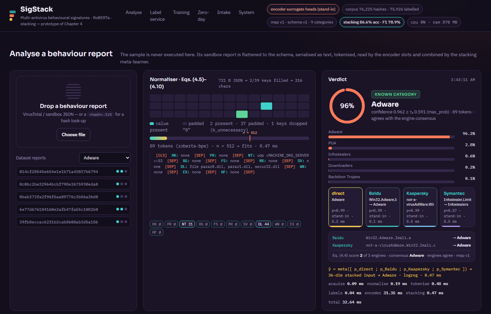
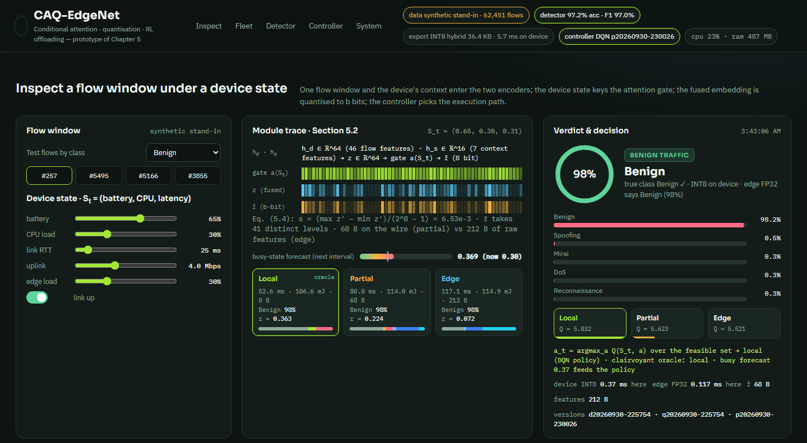
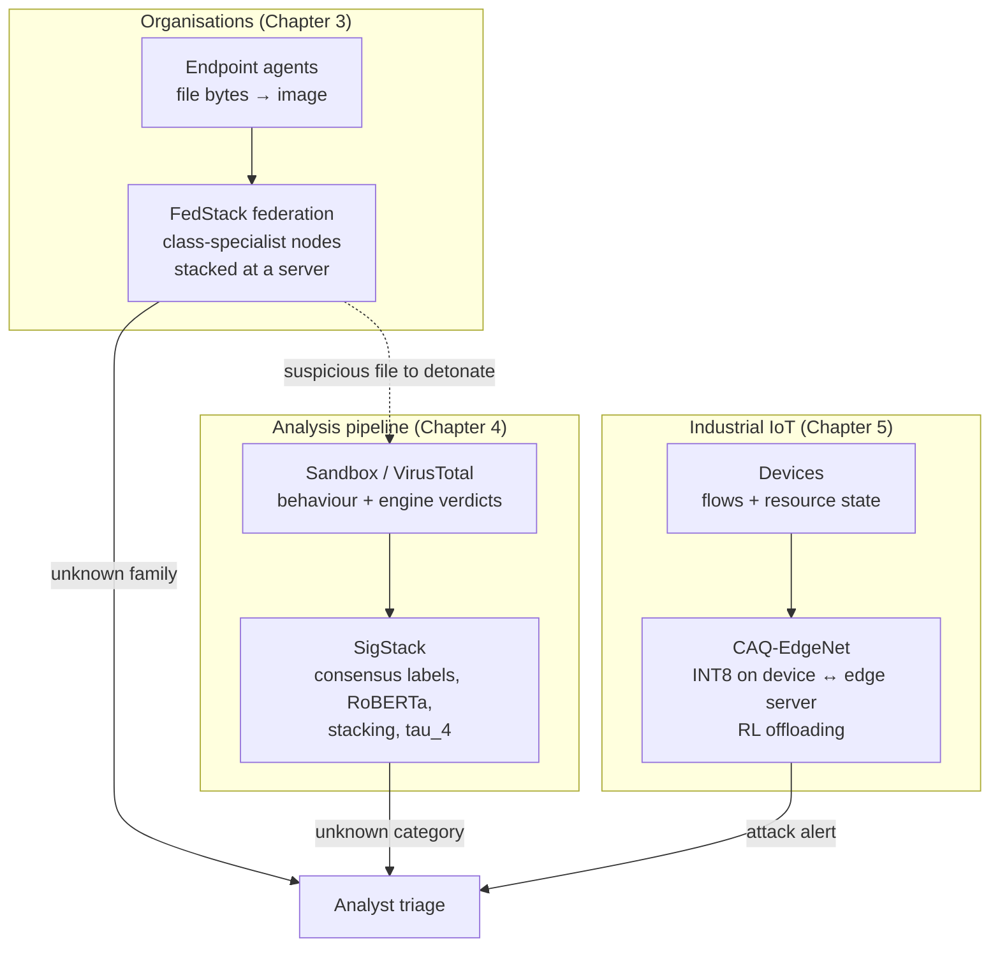

# Detecting Known and Unknown Malware: System Prototypes of Three Frameworks

**Runnable prototypes accompanying the PhD thesis *Novel Way to Detect Known and Unknown Malware Attacks Prediction and Classification using Machine Learning* (Hassan Ishfaq, COMSATS University Islamabad, Wah Campus, 2026)**

[](#quick-start)
[](FedStack-Prototype/LICENSE)
[](https://doi.org/10.1371/journal.pone.0339907)
[](#the-three-prototypes)

---

## Overview

Malware keeps evolving through packing, polymorphism, obfuscation and sandbox evasion. Signature-based defences therefore remain accurate on known threats but blind to new ones. The thesis addresses the detection of **known and unknown (zero-day) malware** with three frameworks. Each is designed for a different observation point and deployment regime:

| | Chapter 3 · FedStack | Chapter 4 · SigStack | Chapter 5 · CAQ-EdgeNet |
|---|---|---|---|
| **What is observed** | the file's raw bytes (static, execution-free) | the file's runtime behaviour in a sandbox (dynamic) | the device's network traffic and its own resource state |
| **Representation** | grayscale byte image | flattened behaviour report serialised as text | 46 flow features + 7 device-context features |
| **Core model** | class-specialist ResNet-50 nodes, stacked by an accuracy-weighted meta-learner | RoBERTa encoders per antivirus engine, stacked by a meta-learner | multi-modal encoder with conditional attention and quantisation-aware compression |
| **Key idea** | federated learning **without parameter averaging**: organisations share predictions and quantised weights, never samples | **multi-antivirus consensus** labels through a versioned category map | a **reinforcement-learning controller** chooses local, partial or edge execution per request |
| **Zero-day mechanism** | open-set threshold on meta-learner confidence | unknown-category threshold τ₄ and a category hold-out protocol | per-request detection under changing resources |
| **Deployment target** | a federation of organisations plus endpoint agents | a server-side analysis pipeline behind a sandbox | IIoT and mobile devices with a nearby edge server |

The three views are **complementary**. Byte images are fast and need no execution, but files that share a packer look alike. Behaviour reports are insensitive to packing, but they depend on a sandbox and can be evaded. Traffic-level detection protects constrained devices that can analyse neither binaries nor behaviour.

This repository contains one **system prototype** per framework. Each is a runnable, end-to-end implementation of the thesis's reference architecture, with a model-serving path, the decision logic, measurement of cost and resources, and an analyst dashboard. Every number on a dashboard is computed by the running process; nothing is hard-coded.

## The three prototypes

<table>
<tr>
<td width="33%" valign="top">
<a href="FedStack-Prototype/README.md"></a>
<h3><a href="FedStack-Prototype/README.md">FedStack-Prototype</a></h3>
<b>Chapter 3.</b> Federated stacked-ensemble malware detection on byte images. Four class-specialist nodes, accuracy-aware stacking, open-set zero-day flagging, per-round payload accounting against FedAvg, endpoint folder watcher.
<br><br><i>Published: PLOS ONE 21(1): e0339907, 2026.</i>
</td>
<td width="33%" valign="top">
<a href="SigStack-Prototype/README.md"></a>
<h3><a href="SigStack-Prototype/README.md">SigStack-Prototype</a></h3>
<b>Chapter 4.</b> Multi-antivirus behavioural-signature detection. Label service with a versioned category map, schema-based normaliser, RoBERTa model slots, stacking, unknown-category rule, category hold-out study.
<br><br><i>Journal version under review.</i>
</td>
<td width="33%" valign="top">
<a href="CAQ-EdgeNet-Prototype/README.md"></a>
<h3><a href="CAQ-EdgeNet-Prototype/README.md">CAQ-EdgeNet-Prototype</a></h3>
<b>Chapter 5.</b> Adaptive malware and intrusion detection for Industrial IoT. Conditional attention, quantisation-aware compression, executed precision variants, reinforcement-learning offloading, live device fleet.
<br><br><i>Journal version under review.</i>
</td>
</tr>
</table>

## How the frameworks fit together



## Shared engineering principles

The three prototypes were built on the same four rules. Chapter 6 of the thesis identifies them as the transferable lessons for real deployments.

1. **Configuration-driven model slots.** The same software runs with CPU stand-in models on a laptop and with the trained thesis models in production. Placing the trained checkpoints in `models/` switches each slot automatically.
2. **Cache every expensive step.** The dataset caches, the per-hash report cache, the feature space and the trained state are built once and reused.
3. **Reduced-precision export, separate from full-precision training.** Examples are INT8 weights per federated round (Chapter 3), dynamic INT8 for the transformer on CPU hosts (Chapter 4), and a sensitivity-aware hybrid precision on devices (Chapter 5).
4. **Calibrated rejection instead of forced classification.** A confidence threshold is set from a false-alarm budget β on *known* data and calibrated out-of-fold. Unseen families or categories are then reported as unknown with a predictable analyst workload.

## Quick start

**Requirements.** Python 3.10 or newer on Windows, Linux or macOS. No GPU is needed to run any of the prototypes.

```bash
git clone <repository-url>
cd <repository>

# Chapter 3 — needs the image dataset (FigShare, see FedStack-Prototype/docs/DATASETS.md)
cd FedStack-Prototype
python -m pip install -r requirements.txt
python scripts/prepare_data.py
python run.py                      # http://127.0.0.1:8765
cd ..

# Chapter 4 — needs a behaviour-report archive (see SigStack-Prototype/docs/DATASETS.md)
cd SigStack-Prototype
python -m pip install -r requirements.txt
python scripts/prepare_data.py
python run.py                      # http://127.0.0.1:8766
cd ..

# Chapter 5 — runs immediately on a synthetic stand-in; CIC-IoT-2023 optional
cd CAQ-EdgeNet-Prototype
python -m pip install -r requirements.txt
python run.py                      # http://127.0.0.1:8767
```

The three servers use different ports and can run at the same time. Each serves its interactive API documentation at `/api/docs`.

## Results at a glance

The tables below separate the **results reported in the thesis**, obtained with the trained models on the real datasets, from the **measurements of the prototypes** in this repository. The prototype measurements use stand-in models or synthetic data until the trained models or datasets are plugged in. The detailed tables are in each prototype's `docs/EVALUATION.md`.

### Reported in the thesis

| Chapter | Headline result | Source |
|---|---|---|
| 3 · FedStack | 97.80 % accuracy on 28 malware families (ResNet-50 nodes); 94.6 % detection rate on held-out zero-day families; upload per round 8× smaller than FedAvg | Tables 3.6, 3.11, 3.12 |
| 4 · SigStack | 94.3 % accuracy (F1 0.952) for RoBERTa + voting + stacking; macro-F1 92.99 % with multi-AV consensus labels; macro-F1 0.81–0.89 on held-out categories | Tables 4.7, 4.9, 4.12 |
| 5 · CAQ-EdgeNet | 96.72 ± 0.35 % five-fold accuracy; 93.8 % offloading-decision accuracy; 72 ms and 2.41 J per request vs 185 ms and 4.32 J local-only; INT8 model 2.1 MB and 5.4 ms | Tables 5.4, 5.5, 5.7, 5.8 |

### Measured on the prototypes (CPU only: AMD Ryzen 7 7700, 32 GB, no GPU)

| Prototype | What runs | Selected measurements |
|---|---|---|
| FedStack | stand-in nodes; cost figures also with ResNet-50 checkpoints | stand-in meta-learner 78.3 % accuracy; 33 % of five unseen families flagged unknown at 7.5 % false alarms; four ResNet-50 nodes answer a scan in ≈ 90–125 ms on CPU; 95 MB upload per round, 7.9× below FedAvg |
| SigStack | stand-in encoder on 130,113 real VirusTotal reports | engines agree after mapping on only 50.6 % of multi-engine files; 56 % of reports exceed 512 tokens; stacking 86.6 % accuracy against consensus labels; ≈ 15–35 ms per report |
| CAQ-EdgeNet | trained detector and RL controller on synthetic flows and simulated devices | 97.2 % detector accuracy; hybrid INT8 export 70 % smaller for −0.06 points; learned controller 95 % agreement with a clairvoyant oracle vs 76 % for rule-based; 17 % lower latency than rule-based |

## Repository layout

```
.
├── README.md                    this overview
├── FedStack-Prototype/          Chapter 3 — federated stacked ensemble on byte images
│   ├── README.md
│   ├── docs/                    METHODOLOGY · ARCHITECTURE · EVALUATION · DATASETS · CONFIGURATION
│   ├── fedstack/  web/  scripts/  config.yaml  run.py  requirements.txt
│   └── LICENSE  CITATION.cff
├── SigStack-Prototype/          Chapter 4 — multi-antivirus behavioural signatures
│   ├── README.md
│   ├── docs/
│   ├── sigstack/  web/  scripts/  config.yaml  category_map.yaml  run.py  requirements.txt
│   └── LICENSE  CITATION.cff
└── CAQ-EdgeNet-Prototype/       Chapter 5 — adaptive IIoT detection with RL offloading
    ├── README.md
    ├── docs/
    ├── caqedge/  web/  config.yaml  run.py  requirements.txt
    └── LICENSE  CITATION.cff
```

## Documentation

Each prototype carries the same documentation set:

| Document | FedStack | SigStack | CAQ-EdgeNet |
|---|---|---|---|
| Overview and quick start | [README](FedStack-Prototype/README.md) | [README](SigStack-Prototype/README.md) | [README](CAQ-EdgeNet-Prototype/README.md) |
| Formal method, equations and design rationale | [METHODOLOGY](FedStack-Prototype/docs/METHODOLOGY.md) | [METHODOLOGY](SigStack-Prototype/docs/METHODOLOGY.md) | [METHODOLOGY](CAQ-EdgeNet-Prototype/docs/METHODOLOGY.md) |
| Components, data flow and HTTP API | [ARCHITECTURE](FedStack-Prototype/docs/ARCHITECTURE.md) | [ARCHITECTURE](SigStack-Prototype/docs/ARCHITECTURE.md) | [ARCHITECTURE](CAQ-EdgeNet-Prototype/docs/ARCHITECTURE.md) |
| Protocols, measured results and reproduction | [EVALUATION](FedStack-Prototype/docs/EVALUATION.md) | [EVALUATION](SigStack-Prototype/docs/EVALUATION.md) | [EVALUATION](CAQ-EdgeNet-Prototype/docs/EVALUATION.md) |
| Data sources, layout and ethics | [DATASETS](FedStack-Prototype/docs/DATASETS.md) | [DATASETS](SigStack-Prototype/docs/DATASETS.md) | [DATASETS](CAQ-EdgeNet-Prototype/docs/DATASETS.md) |
| Every configuration key | [CONFIGURATION](FedStack-Prototype/docs/CONFIGURATION.md) | [CONFIGURATION](SigStack-Prototype/docs/CONFIGURATION.md) | [CONFIGURATION](CAQ-EdgeNet-Prototype/docs/CONFIGURATION.md) |

## Data availability

| Prototype | Data | Availability |
|---|---|---|
| FedStack | 28-family malware image dataset of the paper | FigShare, [doi:10.6084/m9.figshare.29107697](https://doi.org/10.6084/m9.figshare.29107697) |
| SigStack | VirusTotal behaviour reports labelled by three antivirus engines | not redistributed (VirusTotal terms); format and construction in [DATASETS](SigStack-Prototype/docs/DATASETS.md) |
| CAQ-EdgeNet | CIC-IoT-2023 network flows | Canadian Institute for Cybersecurity, [iotdataset-2023](https://www.unb.ca/cic/datasets/iotdataset-2023.html); a synthetic stand-in is built in |

No datasets, caches or trained models are stored in this repository. The research code used for the Chapter 3 experiments is available at [github.com/jhshah101/Zero-Day-Malware-Detection](https://github.com/jhshah101/Zero-Day-Malware-Detection). The FedStack prototype loads the checkpoints it writes.

## Responsible use

None of the prototypes executes the samples it analyses. FedStack reads files as bytes; SigStack reads behaviour reports; CAQ-EdgeNet reads flow statistics. The datasets contain *derived* representations: images, reports and flow features. Handle real malware only inside isolated analysis environments, respect the licences and terms of every data source, and never commit API keys.

## Citation

If you use this software, please cite the thesis:

```bibtex
@phdthesis{ishfaq2026thesis,
  title  = {Novel Way to Detect Known and Unknown Malware Attacks Prediction and Classification using Machine Learning},
  author = {Ishfaq, Hassan},
  school = {COMSATS University Islamabad, Wah Campus},
  year   = {2026}
}
```

and, for the Chapter 3 framework, the article:

```bibtex
@article{ishfaq2026fedstack,
  title   = {A distributed framework for zero-day malware detection using federated ensemble models},
  author  = {Ishfaq, Hassan and Shah, Jamal Hussain and Saleem, Rabia and Afzal, Maira},
  journal = {PLOS ONE},
  volume  = {21},
  number  = {1},
  pages   = {e0339907},
  year    = {2026},
  doi     = {10.1371/journal.pone.0339907}
}
```

Journal articles on the Chapter 4 framework (*Multi-AV's Signature-Based Deep Learning Framework for Zero-Day Malware and Intrusion Detection in Electronic Systems*) and the Chapter 5 framework (*CAQ-EdgeNet: An Adaptive Framework for Malware Detection in Mobile Industrial IoT Systems*) are under review. Each prototype folder contains a `CITATION.cff` with its metadata.

## License and acknowledgements

The software in each folder is released under the MIT License (see the `LICENSE` file in each folder). Datasets and third-party data are distributed under their own terms.

