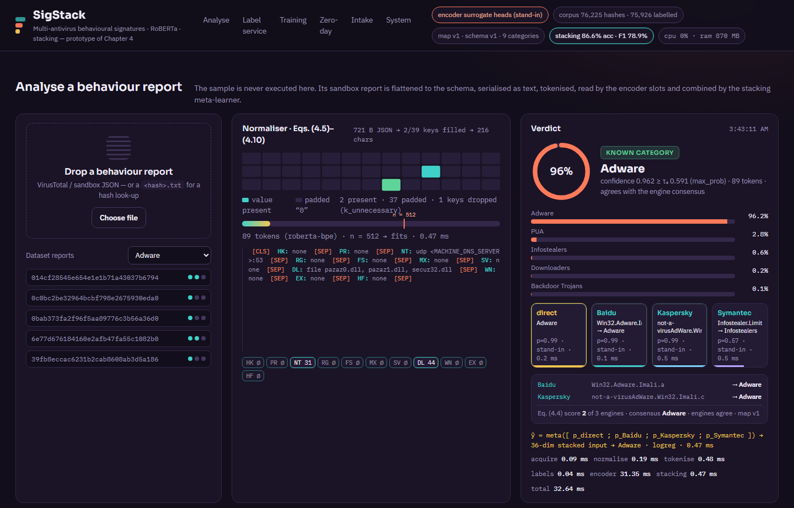
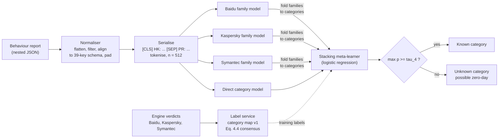
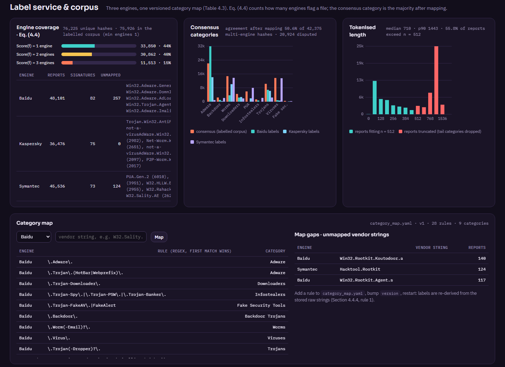
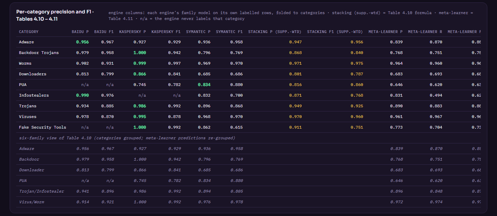
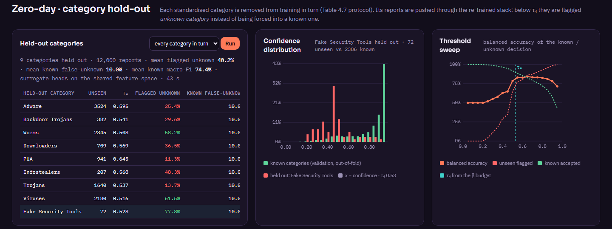

# SigStack-Prototype

**A runnable system prototype of the multi-antivirus behavioural-signature framework for zero-day malware detection, with transformer encoders and stacking**

[](requirements.txt)
[](LICENSE)
[](#citation)
[](docs/METHODOLOGY.md#5-encoder-slots)



---

## Overview

Signature-based antivirus engines are fast and precise on known malware, but they disagree with one another and have little to say about zero-day samples. Three difficulties stand out:

- **Vendor bias.** Each engine uses its own naming scheme and has its own blind spots. A model trained on one vendor's labels learns that vendor's blind spots.
- **Unstructured behaviour.** Sandbox reports are deeply nested JSON documents of hooks, processes, network, registry, file-system, mutex, service and DLL events. Conventional classifiers need hand-crafted features to use them.
- **Unknown categories.** A closed-set classifier forces every new sample into a known class.

The framework of thesis Chapter 4 addresses these difficulties in three steps:

1. **Multi-antivirus consensus labelling.** The verdicts of three engines are mapped to one standardised category set through a versioned category map. The consensus label is taken over the engines that flag the file (Eq. 4.4).
2. **Behavioural signatures as text.** The nested behaviour report is flattened, aligned to a fixed key set and padded (Eqs. 4.5–4.10). It is then serialised as a `[CLS] key: value [SEP] …` sequence and read by a fine-tuned **RoBERTa** encoder, whose self-attention relates events that are far apart in the report.
3. **Stacking.** Per-engine family models and a direct category model are combined by a meta-learner. A calibrated confidence threshold τ₄ (Eq. 4.11) reports unseen categories as **unknown (possible zero-day)** instead of forcing them into a known one.

This repository contains the **system prototype** of that framework. It is an end-to-end, runnable service with intake, behaviour acquisition, label service, normaliser, encoder service, stacking service, verdict store and analyst dashboard. It was built for the design-and-deployment chapter of the PhD thesis, and every number on the dashboard is measured by the running process.

The prototype runs on a CPU-only machine. Each model slot switches automatically to a fine-tuned RoBERTa model as soon as its folder is placed in `models/`. Until then it uses a clearly labelled *stand-in* encoder over the same serialised text.

## What the prototype demonstrates

| Capability | Where it is implemented | Thesis reference |
|---|---|---|
| Reads 130,113 VirusTotal behaviour reports in place from a zip archive (76,225 unique hashes, three engines) | [`scripts/prepare_data.py`](scripts/prepare_data.py) | Section 4.1, Table 4.2 |
| Normaliser: flatten → filter → align to the 39-key schema → pad → serialise; path canonicalisation; segment report | [`sigstack/flatten.py`](sigstack/flatten.py) | Eqs. 4.5–4.10, Section 4.2 |
| Real RoBERTa byte-level BPE token counting and the n = 512 truncation policy | [`sigstack/tokenizer.py`](sigstack/tokenizer.py) | Table 4.14 |
| Label service: versioned regex category map, Eq. 4.4 score, majority consensus, dispute and map-gap reporting | [`sigstack/labels.py`](sigstack/labels.py), [`category_map.yaml`](category_map.yaml) | Table 4.3, Section 4.4.4 |
| Four model slots: a direct category model and one family model per engine, as RoBERTa or CPU stand-in | [`sigstack/encoder.py`](sigstack/encoder.py) | Sections 4.2–4.3 |
| Stratified k-fold protocol, out-of-fold stacking, support-weighted Stacking Precision / F1 | [`sigstack/engine.py`](sigstack/engine.py), [`sigstack/stacking.py`](sigstack/stacking.py) | Tables 4.4–4.12 |
| Unknown-category rule τ₄, calibrated out-of-fold from a false-alarm budget | `stacking.calibrate_threshold` | Eq. 4.11 |
| Category hold-out study: each category removed from training in turn | `Engine.run_holdout` | Table 4.7 |
| Intake watcher and hash look-up (corpus → report cache → VirusTotal API) | `Engine._acquire`, [`sigstack/vt.py`](sigstack/vt.py) | Section 4.4.2 |
| Verdict store recording the model, category-map and schema versions of every decision | `data/verdicts.jsonl` | Section 4.4.5 |

## Method at a glance



The formal description, with the equations of the normaliser, the label service, the encoder, the stacking scheme, the unknown-category rule and the design rationale, is in [docs/METHODOLOGY.md](docs/METHODOLOGY.md).

## Quick start

**Requirements.** Python 3.10 or newer. A GPU is not needed.

```bash
git clone <this-repository-url> SigStack-Prototype
cd SigStack-Prototype
python -m pip install -r requirements.txt
```

**Data.** Place the behaviour-report archive at `datasets/multi_av_behaviour_reports.zip`. The expected layout is `<root>/<engine>/<family>/<md5>.json`, and a plain folder with the same layout also works (`data.reports_dir`). The corpus of the thesis is **not** redistributed here; [docs/DATASETS.md](docs/DATASETS.md) explains the format and how to build a compatible corpus.

```bash
python scripts/prepare_data.py      # once (≈ 45 s for 130k reports): report cache, token counts, demo samples
python run.py                       # starts the server and opens http://127.0.0.1:8766
```

On first start the stand-in feature space is built in the background, which takes about 20–30 s.

**First steps on the dashboard.**

1. Open **Training protocol** and press *Run training protocol*. It runs 5-fold stratified cross-validation on 30,000 reports and takes about 30 s to 2 min, depending on the machine.
2. Open **Zero-day · category hold-out** and run *every category in turn*.
3. Click a dataset report under **Analyse a behaviour report**, or drop a JSON report or a `<hash>.txt` file.

The HTTP API is documented interactively at `http://127.0.0.1:8766/api/docs`.

## Using fine-tuned RoBERTa models

1. Fine-tune with [`scripts/colab_finetune_roberta.py`](scripts/colab_finetune_roberta.py) on Colab or any GPU. The script uses `roberta-base`, n = 512, batch 8, 500 warm-up steps and weight decay 0.01, with optional stratified k-fold. Run it once per slot: `--slot category` and `--slot Baidu|Kaspersky|Symantec`. The script imports this repository's normaliser, so training and serving see identical text.
2. Copy the folders it writes to `models/roberta_category`, `models/roberta_Baidu`, `models/roberta_Kaspersky` and `models/roberta_Symantec`.
3. Leave `encoder.mode: auto` and restart. Every slot whose folder exists switches to RoBERTa, and the others keep the stand-in.

`scripts/make_test_checkpoint.py` writes a tiny random-weight folder to test the loader. See [models/README.md](models/README.md).

## Dashboard

| Panel | What it shows |
|---|---|
| **Analyse a behaviour report** | Schema grid (present or padded keys), token meter with the n = 512 cut, serialised text with `[CLS]`/`[SEP]`, and the segments kept, partially kept or dropped. Then the four slot replies, the stacked verdict, the τ₄ decision, the engine strings with their mapped categories and Eq. 4.4 score, and per-stage timings on the pipeline map. |
| **Label service & corpus** | Engine coverage (score 1/2/3), category distributions per engine and for the consensus, engine agreement after mapping, token-length histogram, the rule table, unmapped vendor strings (map gaps) and a try-a-string box. |
| **Training protocol** | Per-fold accuracy per slot, labelling-strategy comparison, per-category precision and F1 with the support-weighted stacking formula, family-level metrics per engine, and the confidence histogram with τ₄. |
| **Zero-day · category hold-out** | Per held-out category: share flagged unknown, known false-unknown rate, nearest known category, and the confidence histogram and threshold sweep. |
| **Intake** | Folder watcher; the verdict store with model, map and schema versions. |
| **System** | Model slots and files, process CPU and memory, the Table 4.14 cost rows next to the measured size of what is loaded. |

<table>
<tr><td></td></tr>
<tr><td></td></tr>
<tr><td></td></tr>
</table>

## Results

### Reported in the thesis (fine-tuned RoBERTa, GPU training)

| Quantity | Value | Source |
|---|---|---|
| Full model (RoBERTa + multi-source voting + stacking), accuracy / F1 | 94.3 % / 0.952 | Thesis Table 4.12 |
| RoBERTa alone, accuracy / F1 | 89.7 % / 89.1 % | Thesis Table 4.12 |
| Strongest sequential baseline (LSTM), accuracy / F1 | 88.2 % / 87.6 % | Thesis Table 4.12 |
| Multi-AV consensus labelling with stacking: precision / recall / macro-F1 | 94.29 % / 92.14 % / 92.99 % | Thesis Table 4.9 |
| Category hold-out (unseen category), macro-F1 across the nine categories | 0.81 – 0.89 | Thesis Table 4.7 |

### Measured on this prototype (stand-in encoder, AMD Ryzen 7 7700, no GPU)

These figures come from the **CPU stand-in encoder** (hashing TF-IDF → SVD → linear heads), **not** from RoBERTa. They show that the pipeline works end to end. They are not estimates of the thesis model.

| Quantity | Value |
|---|---|
| Corpus: unique hashes / labelled by consensus | 76,225 / 75,926 |
| Engine agreement after mapping (hashes flagged by ≥ 2 engines) | 50.6 % of 42,375 |
| RoBERTa tokens per serialised report: median / p90 / share over 512 | 710 / 1,443 / 55.8 % |
| Stacking, 5-fold out-of-fold on 30,000 reports: accuracy / macro-F1 | 86.6 % / 0.789 |
| Direct category model alone / soft voting: macro-F1 | 0.788 / 0.764 |
| Per-engine family model on its own labels (Baidu / Kaspersky / Symantec), category accuracy | 94.3 % / 94.4 % / 91.4 % |
| τ₄ at β = 0.10 | 0.591 |
| Category hold-out, all nine categories: mean share flagged unknown at 10 % known false alarms | 40.2 % |
| Analysis of one report (normalise + tokenise + 4 slots + stacking) | ≈ 15–35 ms |
| Resident memory (report cache + feature space + models) | ≈ 0.9 GB |

The full protocol, all tables and the reproduction steps are in [docs/EVALUATION.md](docs/EVALUATION.md).

## Repository structure

```
SigStack-Prototype/
├── config.yaml            engines, normaliser, label service, encoder slots, training, open-set, acquisition, watcher
├── category_map.yaml      versioned vendor-string → standardised-category rules (Table 4.3)
├── run.py                 launcher (uvicorn + browser)
├── sigstack/
│   ├── flatten.py         Eqs. 4.5–4.10: flatten, filter, align, pad, serialise
│   ├── labels.py          category map, Eq. 4.4 score, consensus
│   ├── tokenizer.py       RoBERTa BPE token counting (n = 512 policy)
│   ├── encoder.py         model slots: RobertaSlot | SurrogateSlot (+ Table 4.14 closed forms)
│   ├── stacking.py        meta-learner, metrics, support-weighted stacking, τ₄ calibration
│   ├── engine.py          label service over the corpus, training protocol, analysis path, hold-out, watcher
│   ├── vt.py              VirusTotal v3 adapter (optional) and v3 → schema v1 conversion
│   ├── api.py             FastAPI endpoints
│   └── config.py          configuration loading
├── web/                   dashboard (HTML/CSS/JS, no build step)
├── scripts/
│   ├── prepare_data.py            report cache, token counts, demo samples
│   ├── colab_finetune_roberta.py  fine-tunes the RoBERTa slots with this repository's normaliser
│   └── make_test_checkpoint.py    tiny random-weight RoBERTa folder for testing the loader
├── datasets/              place the report archive here (not versioned)
├── models/                place fine-tuned RoBERTa folders here (not versioned)
└── docs/                  methodology, architecture, evaluation, datasets, configuration
```

## Documentation

| Document | Content |
|---|---|
| [docs/METHODOLOGY.md](docs/METHODOLOGY.md) | Problem formulation, label service, normaliser and serialisation, encoder slots, stacking, unknown-category rule, training and hold-out protocols, cost model, design rationale |
| [docs/ARCHITECTURE.md](docs/ARCHITECTURE.md) | Components, analysis path, training sequence, runtime model, persistence and versioning, HTTP API |
| [docs/EVALUATION.md](docs/EVALUATION.md) | Protocols, metrics, measured results, reproduction steps, threats to validity |
| [docs/DATASETS.md](docs/DATASETS.md) | Report format, archive layout, building a compatible corpus, licensing and ethics |
| [docs/CONFIGURATION.md](docs/CONFIGURATION.md) | Every key of `config.yaml` and `category_map.yaml` |

## Limitations

- **External behaviour source.** The framework depends on a sandbox or VirusTotal for behaviour reports. Sandbox-aware malware produces short or empty reports, which the unknown-category rule flags but cannot classify. The dashboard marks very short reports.
- **Hand-maintained map.** The category map is maintained by hand, and its errors propagate to the labels. Versioning makes errors reversible and auditable, but it does not prevent them.
- **Server-side cost.** The RoBERTa encoder costs 48.3 G multiply-accumulates per 512-token sequence, which confines it to server-side use. The analytical cost rows are shown on the System panel.
- **Stand-in numbers.** Accuracy and hold-out figures obtained with the stand-in encoder demonstrate the mechanism. They are not estimates of the thesis model.

## Responsible use

The prototype never executes samples; it only reads behaviour reports. Reports and verdicts obtained from VirusTotal are subject to the [VirusTotal Terms of Service](https://docs.virustotal.com/docs/terms-of-service). Do not commit API keys or redistribute report corpora without permission.

## Citation

Please cite the PhD thesis (Chapter 4):

```bibtex
@phdthesis{ishfaq2026thesis,
  title  = {Novel Way to Detect Known and Unknown Malware Attacks Prediction and Classification using Machine Learning},
  author = {Ishfaq, Hassan},
  school = {COMSATS University Islamabad, Wah Campus},
  year   = {2026},
  note   = {Chapter 4}
}
```

A journal article describing the method, *Multi-AV's Signature-Based Deep Learning Framework for Zero-Day Malware and Intrusion Detection in Electronic Systems* (H. Ishfaq, J. H. Shah, S. ur Rehman, R. Saleem, M. Afzal), is under review. Machine-readable metadata is in [CITATION.cff](CITATION.cff).

## License and acknowledgements

This software is released under the [MIT License](LICENSE). Behaviour reports and antivirus verdicts are third-party data and are not covered by this license.

The work was carried out at the Department of Computer Science, COMSATS University Islamabad, Wah Campus, under the supervision of Dr. Jamal Hussain Shah and the co-supervision of Dr. Saeed ur Rehman.

**Companion repositories** of the same thesis: *FedStack-Prototype* (Chapter 3, federated stacked ensembles on byte images) and *CAQ-EdgeNet-Prototype* (Chapter 5, adaptive malware detection on Industrial IoT edge devices).
