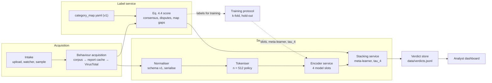
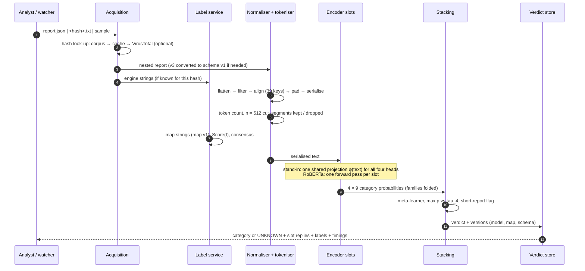
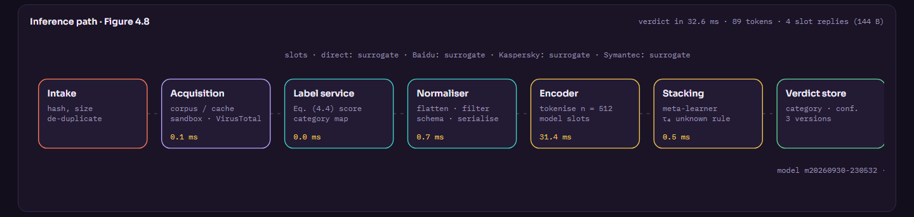
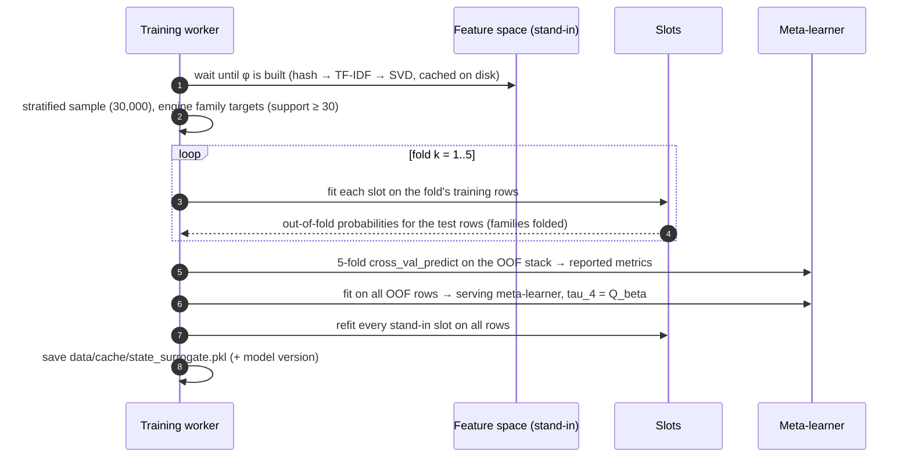

# System architecture

This document describes the components of the prototype, the path of one report through it, the training sequence, the runtime model with persistence and versioning, and the HTTP API. It follows the reference architecture of thesis Section 4.4.2.

## 1. Components



| Component | Responsibility | Module / class |
|---|---|---|
| Intake | Receives a JSON report, a `<hash>.txt` or a dataset sample; computes MD5 and SHA-256 of the submitted bytes | `api.py`, `Engine.analyze`, `Engine._watch_loop` |
| Behaviour acquisition | Returns the report: a raw JSON upload, a corpus hit by hash, a report-cache hit, or a VirusTotal v3 fetch (optional, cached by hash) | `Engine._acquire`, `vt.py` |
| Label service | Maps vendor strings to categories, computes the Eq. 4.4 score and the consensus; corpus statistics and map gaps | `labels.py`, `Engine._build_labels` |
| Normaliser | Flatten, filter, path canonicalisation, align to schema v1, pad, serialise, segment report | `flatten.py` |
| Tokeniser | RoBERTa byte-level BPE token count and truncation point (approximate splitter if offline) | `tokenizer.py` |
| Encoder service | Four slots (direct category + one per engine); RoBERTa or stand-in per slot | `encoder.py` |
| Stacking service | Fold family probabilities to categories, logistic-regression meta-learner, τ₄ rule | `stacking.py`, `Engine.analyze` |
| Verdict store | Append-only JSON lines with the verdict, engine strings, token count and the model, map and schema versions | `Engine._store_verdict` |
| Training | Stratified k-fold protocol, out-of-fold stacking, metrics, category hold-out | `Engine._train`, `Engine._holdout` |

## 2. Path of one report



Every stage is timed (`acquire`, `normalise`, `tokenise`, `label_service`, `encoder`, `stacking`, `total`) and shown on the pipeline map of the dashboard:



## 3. Training sequence



The category hold-out study (`/api/holdout/run`) runs in its own worker. It builds temporary slots and a temporary meta-learner per held-out category and never modifies the serving models.

## 4. Module reference

| Module | Main contents |
|---|---|
| `sigstack/config.py` | `Config`: YAML loading, engines and display names, RoBERTa slot folders, summary for the UI |
| `sigstack/flatten.py` | `SCHEMA_V1`, `flatten`, `filter_keys`, `align`, `serialize`, `normalise_report`, `display_text`, path aliases |
| `sigstack/labels.py` | `CategoryMap` (compiled rules, memoised), `consensus`, `score`, `label_report`, `UNMAPPED` |
| `sigstack/tokenizer.py` | `TokenCounter`: RoBERTa tokenizer through `transformers` if available, otherwise an approximate splitter |
| `sigstack/encoder.py` | `SurrogateFeaturizer` (fast sparse projection), `SurrogateSlot`, `RobertaSlot`, the Table 4.14 closed forms |
| `sigstack/stacking.py` | `fold_to_categories`, `make_meta`, `per_class_metrics`, `summary_metrics`, `support_weighted_stacking`, `confidence`, `calibrate_threshold` |
| `sigstack/engine.py` | `Engine`: boot, label service over the corpus, slot construction and state restore, training protocol, analysis path, hold-out study, watcher, status |
| `sigstack/vt.py` | `fetch_behaviour` (VirusTotal v3 behaviour summary and engine results), `v3_to_v1` conversion |
| `sigstack/api.py` | FastAPI application; serves the API and the static dashboard |
| `scripts/prepare_data.py` | Streams the archive, normalises every unique hash, counts tokens, writes `data/cache/reports.pkl` and demo samples |

## 5. Runtime model, persistence and versioning

| Aspect | Implementation |
|---|---|
| Web server | Uvicorn serving a FastAPI app; static dashboard with no build step |
| Background work | Feature-space build at start-up, the training protocol and the hold-out study run in daemon threads; the dashboard polls their state |
| Consistency | Slot heads are swapped in only once fully fitted, so concurrent analyses and status calls never see a half-built model |
| Report cache | `data/cache/reports.pkl`: hashes, serialised texts (≤ 3,000 characters), token counts, event counts, per-engine strings, schema version (≈ 140 MB for 76k reports) |
| Feature space | `data/cache/features_surrogate.pkl`: TF-IDF weights, SVD components and the projected corpus, keyed by the report cache's build time |
| Trained state | `data/cache/state_surrogate.pkl`: slot heads, meta-learner, τ₄, metrics, fold history, model version. It is discarded automatically if the category map, report cache or feature space changes |
| Verdict store | `data/verdicts.jsonl`, one JSON object per verdict |
| Versions | `model` (training run time stamp), `category_map` (`version` in `category_map.yaml`), `schema` (`normalizer.schema_version`) are attached to every verdict |

## 6. HTTP API

All endpoints return JSON. The interactive OpenAPI documentation is served at `/api/docs`.

| Method | Path | Purpose |
|---|---|---|
| GET | `/api/status` | Slots and their kinds, label statistics, token statistics, metrics summary, τ₄, versions, cost table, resources, configuration summary, recent verdicts |
| GET | `/api/events?since=<id>` | Event-log entries newer than `id` |
| GET | `/api/resources` | Process CPU, resident memory, threads, and system CPU and RAM |
| POST | `/api/analyze` | Multipart upload (`file`, at most 32 MB): a JSON behaviour report (schema v1 or VirusTotal v3) or a `<hash>.txt` |
| GET | `/api/samples` | Demo reports per category with their engine strings |
| GET | `/api/samples/file/{path}` | One demo report |
| POST | `/api/analyze_sample` | `{"path": "<Category>/<hash>.json"}` |
| GET | `/api/labels` | Label statistics, map version, categories and rule table |
| POST | `/api/labels/map` | `{"engine": "Symantec", "raw": "W32.Sality.AE"}` → category and the rule that matched |
| POST | `/api/train/run` | Start the training protocol |
| GET | `/api/train/state` | Progress, per-fold history, full metrics, τ₄, model version |
| POST | `/api/holdout/run` | `{"categories": ["PUA", "Worms"]}`, or `null` for every category in turn |
| GET | `/api/holdout/state` | Progress and per-category results |
| POST | `/api/watch` | `{"enabled": true \| false}` |

Examples:

```bash
curl -F "file=@report.json" http://127.0.0.1:8766/api/analyze
curl -X POST -H "Content-Type: application/json" -d '{"engine":"Kaspersky","raw":"not-a-virus:AdWare.Win32.Lollipop.qm"}' http://127.0.0.1:8766/api/labels/map
```

## 7. Extension points

- **Another engine.** Add a folder to `data.engines`, add its rules to `category_map.yaml` and re-run `prepare_data.py`. A new slot appears automatically.
- **Another schema version.** Add a key list to `flatten.SCHEMAS` and set `normalizer.schema_version`. Verdicts record which version produced them.
- **A different encoder.** Implement the `Slot` interface (`fit`, `predict_proba`, `predict_proba_texts`, `payload`, `info`).
- **A sandbox instead of VirusTotal.** Write an adapter that returns the schema-v1 nested layout, as `vt.v3_to_v1` does.
