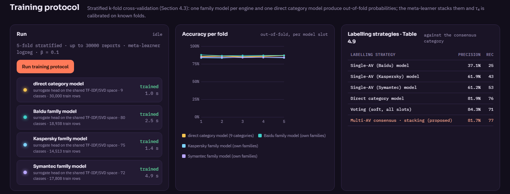
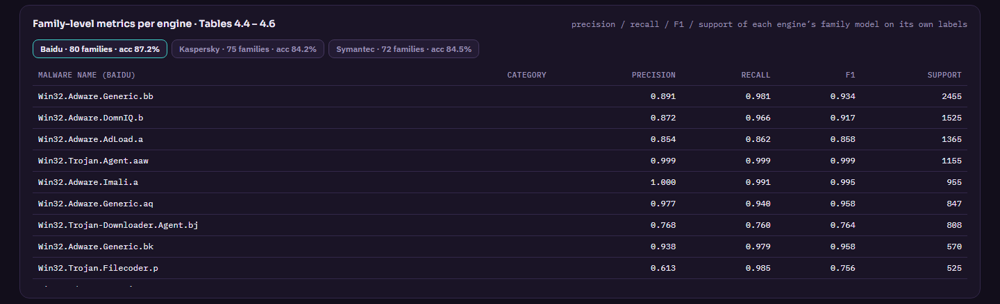
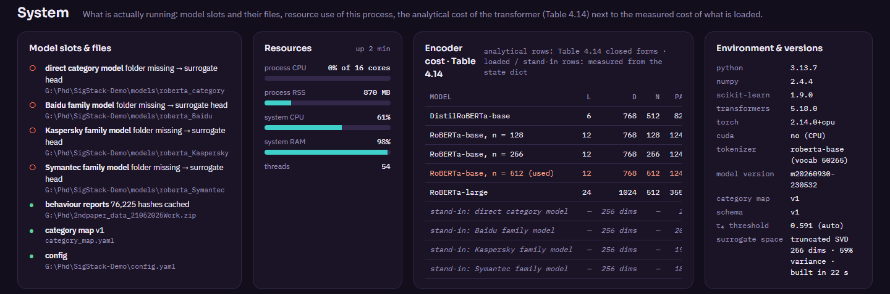

# Evaluation and reproducibility

This document states what is evaluated, how, on which hardware, and what the prototype measured. Two kinds of numbers are kept strictly apart:

- **results of the thesis**, obtained with fine-tuned RoBERTa models trained on GPUs, and
- **measurements of this prototype**, obtained on a CPU-only machine with the **stand-in encoder** (hashing TF-IDF → SVD → linear heads).

Corpus statistics, token counts, latency and memory are properties of the pipeline and carry over. Accuracy figures of the stand-in do **not** estimate the RoBERTa model.

## 1. Environment

| Item | Value |
|---|---|
| CPU | AMD Ryzen 7 7700, 8 cores / 16 threads |
| Memory | 32 GB |
| GPU | none |
| OS | Windows 11 Pro |
| Software | Python 3.13.7, NumPy 2.4, scikit-learn 1.9, transformers 5.18 (tokenizer), PyTorch 2.14 CPU (RoBERTa slots only), FastAPI 0.136 |
| Data | 130,113 VirusTotal behaviour reports of the thesis corpus (Baidu 48,101 / 82 signatures; Kaspersky 36,476 / 75; Symantec 45,536 / 73), 76,225 unique MD5 hashes |

## 2. Corpus and label-service statistics

| Quantity | Value |
|---|---|
| Unique hashes | 76,225 |
| Flagged by 1 / 2 / 3 engines (Eq. 4.4) | 33,850 / 30,862 / 11,513 |
| In the labelled corpus (consensus ≠ Unmapped) | 75,926 |
| Multi-engine hashes whose mapped categories agree | 50.6 % of 42,375 (20,924 disputed) |
| Unmapped vendor strings (map gaps, v1) | 3 (rootkit families, 381 reports) |
| Consensus distribution | Adware 22,297 · Worms 14,837 · Viruses 13,791 · Trojans 10,379 · PUA 5,954 · Downloaders 4,486 · Backdoor Trojans 2,418 · Infostealers 1,311 · Fake Security Tools 453 |
| RoBERTa tokens per serialised report: median / 90th percentile | 710 / 1,443 |
| Share of reports longer than $n = 512$ tokens | 55.8 % |
| Schema keys present per report (of 39): 10th percentile / median / 90th percentile | 3 / 13 / 23 |

The engine-agreement figure is the empirical motivation for consensus labelling. Even after mapping to nine coarse categories, the engines disagree on about half of the files that more than one of them flags.

## 3. Training protocol (stand-in encoder)

Five-fold stratified cross-validation on a stratified sample of 30,000 labelled reports; engine family models on families with at least 30 reports; logistic-regression meta-learner on the 36-dimensional out-of-fold stack; β = 0.10.



### 3.1 Labelling strategies (structure of thesis Table 4.9)

All rows are scored against the **consensus** category on the same 30,000 out-of-fold rows.

| Strategy | Precision | Recall | Macro-F1 | Accuracy |
|---|---|---|---|---|
| Single-AV (Baidu) family model, folded to categories | 37.1 % | 25.7 % | 24.8 % | 42.5 % |
| Single-AV (Kaspersky) family model, folded | 61.9 % | 43.9 % | 45.2 % | 60.8 % |
| Single-AV (Symantec) family model, folded | 61.2 % | 53.2 % | 49.7 % | 52.1 % |
| Direct category model | 81.9 % | 76.9 % | 78.8 % | 86.1 % |
| Soft voting over the four slots | 84.3 % | 71.8 % | 76.4 % | 85.5 % |
| **Multi-AV consensus · stacking** | **81.7 %** | **77.1 %** | **78.9 %** | **86.6 %** |

**Reading.** A single engine's model is a poor predictor of the consensus. It learns that engine's label space, and each engine is silent on the families it does not detect. On its **own** labels each engine model is accurate (Section 3.3). Stacking recovers the consensus and is the best strategy on accuracy and macro-F1. With the stand-in, its margin over the direct model is small. The thesis reports a larger gain with RoBERTa (Section 6).

### 3.2 Per-category metrics of the meta-learner (structure of thesis Tables 4.10–4.11)

| Category | Precision | Recall | F1 | Support | Stacking P, support-weighted | Stacking F1, support-weighted |
|---|---|---|---|---|---|---|
| Adware | 0.839 | 0.870 | 0.854 | 8,810 | 0.947 | 0.956 |
| Backdoor Trojans | 0.768 | 0.751 | 0.759 | 955 | 0.868 | 0.840 |
| Worms | 0.964 | 0.960 | 0.962 | 5,862 | 0.971 | 0.975 |
| Downloaders | 0.683 | 0.693 | 0.688 | 1,773 | 0.801 | 0.787 |
| PUA | 0.646 | 0.620 | 0.633 | 2,353 | 0.816 | 0.860 |
| Infostealers | 0.831 | 0.494 | 0.620 | 518 | 0.871 | 0.768 |
| Trojans | 0.890 | 0.883 | 0.886 | 4,101 | 0.949 | 0.925 |
| Viruses | 0.961 | 0.967 | 0.964 | 5,449 | 0.970 | 0.960 |
| Fake Security Tools | 0.773 | 0.704 | 0.737 | 179 | 0.911 | 0.751 |

The support-weighted columns aggregate each engine's metrics **on its own labels** (Section 6 of [METHODOLOGY.md](METHODOLOGY.md)). They are therefore higher than the meta-learner's metrics against the consensus, which is the harder target. As in the thesis, PUA is the weakest category: the engines disagree most about potentially unwanted applications.

### 3.3 Per-engine family models on their own labels

| Engine | Families modelled | Reports labelled (of 30,000) | Category accuracy | Category macro-F1 | Family accuracy |
|---|---|---|---|---|---|
| Baidu | 80 | 18,938 | 94.3 % | 0.912 | 87.2 % |
| Kaspersky | 75 | 14,513 | 94.4 % | 0.919 | 84.2 % |
| Symantec | 72 | 17,808 | 91.4 % | 0.824 | 84.5 % |



### 3.4 Unknown-category threshold

| Quantity | Value |
|---|---|
| τ₄ at β = 0.10 (out-of-fold) | 0.591 |
| Meta-learner parameters | 333 |
| Duration of the full protocol (5 folds + stacking + refit) | ≈ 30 s to 2 min, depending on machine load |

## 4. Category hold-out (structure of thesis Table 4.7)

Each category is removed from training in turn. The study uses 12,000 stratified reports: base slots are trained on 80 % of the known reports, and the meta-learner and τ₄ on the remaining 20 %. Known false-unknown is 10 % by construction (β).

| Held-out category | Unseen reports | τ₄ | Flagged unknown | Nearest known category | Known macro-F1 |
|---|---|---|---|---|---|
| Adware | 3,524 | 0.595 | 25.4 % | PUA | 0.762 |
| Backdoor Trojans | 382 | 0.541 | 29.6 % | Worms | 0.752 |
| Worms | 2,345 | 0.508 | 58.2 % | Viruses | 0.751 |
| Downloaders | 709 | 0.569 | 36.5 % | Adware | 0.694 |
| PUA | 941 | 0.645 | 11.3 % | Adware | 0.801 |
| Infostealers | 207 | 0.568 | 48.3 % | Adware | 0.724 |
| Trojans | 1,640 | 0.537 | 13.7 % | Adware | 0.700 |
| Viruses | 2,180 | 0.516 | 61.5 % | Worms | 0.728 |
| Fake Security Tools | 72 | 0.528 | 77.8 % | Adware | 0.784 |
| **Mean** | | | **40.2 %** | | **0.744** |

**Reading.** Categories with a distinctive behaviour are flagged most often: Fake Security Tools, Viruses and Worms. Categories that are behaviourally close to a known one are absorbed by it, most clearly PUA into Adware and Trojans into Adware. This is the expected failure mode of any behaviour-based open-set rule. It is also why the nearest known category is reported to the analyst with every unknown verdict.

## 5. Latency and resources



| Quantity | Value |
|---|---|
| `prepare_data.py` on 130,113 reports (read, normalise, tokenise) | ≈ 45 s |
| Stand-in feature space (hash 2¹⁷ → TF-IDF → SVD 256) over 76,225 reports | ≈ 22 s, once, then cached |
| Analysis of one report: acquire + normalise + tokenise + labels + 4 slots + stacking | ≈ 15–35 ms |
| Encoder share of one analysis (shared sparse projection + 4 heads) | ≈ 10–30 ms |
| Resident memory (report cache, feature space, models, dashboard) | ≈ 0.85–0.95 GB |
| Report cache on disk / feature space on disk | ≈ 140 MB / ≈ 350 MB |

For the RoBERTa slots, the analytical cost is 48.3 GMAC per 512-token sequence and 499 MB of FP32 weights per slot (Table 4.14, see [METHODOLOGY.md](METHODOLOGY.md#10-computational-cost-of-the-transformer)). The System panel reports the measured size and load time of any RoBERTa folder that is loaded.

## 6. Results of the thesis

The following were obtained with fine-tuned RoBERTa models on GPUs and are reported here for reference. They are not produced by this repository's stand-in encoder.

| Quantity | Value | Source |
|---|---|---|
| Full model (RoBERTa + multi-source voting + stacking): accuracy / F1 | 94.3 % / 0.9521 | Thesis Table 4.12 |
| RoBERTa + stacking: accuracy / F1 | 93.1 % / 0.9269 | Thesis Table 4.12 |
| RoBERTa + voting: accuracy / F1 | 91.2 % / 90.7 % | Thesis Table 4.12 |
| RoBERTa only: accuracy / F1 | 89.7 % / 89.1 % | Thesis Table 4.12 |
| Baselines, accuracy: SVM (TF-IDF) / random forest / XGBoost / 1-D CNN / LSTM | 82.4 / 84.6 / 86.1 / 87.3 / 88.2 % | Thesis Table 4.12 |
| Multi-AV consensus with stacking: precision / recall / macro-F1 | 94.29 / 92.14 / 92.99 % | Thesis Table 4.9 |
| Category hold-out: macro-F1 per held-out category | 0.81 – 0.89 | Thesis Table 4.7 |

## 7. How to reproduce

```bash
python -m pip install -r requirements.txt
python scripts/prepare_data.py                                   # report cache + token counts + samples
python run.py --no-browser &
curl http://127.0.0.1:8766/api/status                            # wait for "features_ready": true
curl -X POST http://127.0.0.1:8766/api/train/run                 # training protocol
curl http://127.0.0.1:8766/api/train/state                       # repeat until "training": false
curl -X POST -H "Content-Type: application/json" -d '{"categories": null}' http://127.0.0.1:8766/api/holdout/run
curl http://127.0.0.1:8766/api/holdout/state
```

**With fine-tuned RoBERTa slots.** Run `scripts/colab_finetune_roberta.py` once per slot, copy the folders to `models/` and restart. The same protocol then scores the RoBERTa slots, using a subsample per fold (`train.roberta_eval_rows`), and stacks them.

**Determinism.** The stratified sample, the folds, the SVD and the hold-out split use seed 42. Timings vary with machine load.

## 8. Threats to validity

- **Stand-in accuracy is not RoBERTa accuracy.** The stand-in sees hashed n-grams of the same text but no contextual attention. Its role is to exercise the system.
- **Consensus as ground truth.** Labels come from antivirus engines, not from manual analysis. Engine errors that the engines share are invisible to every metric here.
- **Temporal effects.** Folds are random, not temporal. The thesis additionally reports a temporal split (Table 4.7), which this prototype does not reproduce.
- **Truncation.** More than half of the reports exceed 512 tokens. The fixed segment order makes truncation deterministic, but the tail categories (file-system and DLL lists) are often cut for RoBERTa. The stand-in sees up to 3,000 characters.
- **Map dependence.** Every category-level number depends on `category_map.yaml` v1. A different mapping changes the label space and the results.
